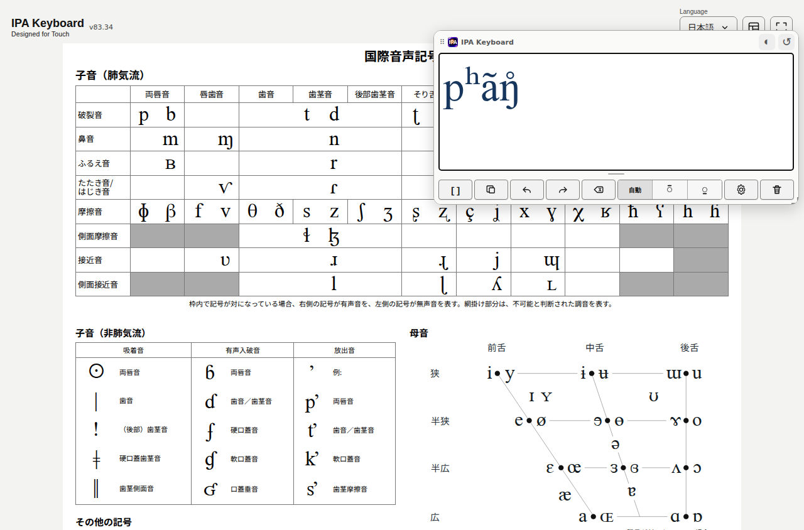
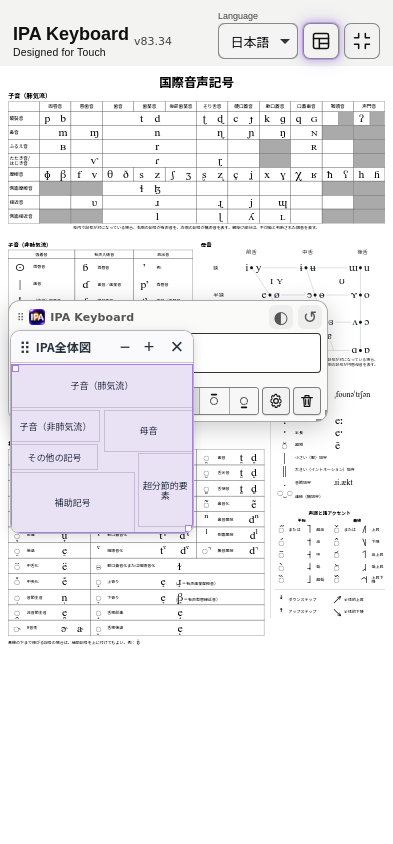

[English](README.md) | [日本語](README.ja.md)

# IPA Keyboard by esaKITs

*Designed for Touch*

音声学の教育・学習や音声転写に使える、多言語対応の国際音声字母（IPA）入力ツールです。チャート上の記号を選び、フローティング入力パネルでUnicode文字列を作成し、教材などにコピーできます。

[公式公開サイトを開く](https://esakits.github.io/ipa-keyboard/)

**v83.34**の公開版の説明です。実装と掲載画像は、コミット[`34b79b4`](https://github.com/esaKITs/ipa-keyboard/commit/34b79b411654fc866b8faee61e00eb393b795485)で検証しています。

## Designed for Touch

チャート自体を入力面として使う設計です。タッチ時の反応や記号のポップアップで選択を助け、移動できる入力パネルによって、使っているチャートの近くで入力結果を確認できます。マウス操作にも対応しています。

## 主な特徴

- 子音・母音・補助記号・超分節的要素・声調の記号をチャートから入力できます。結合文字も扱えます。
- 選択時の視覚的な反応と、記号情報のポップアップを備えています。白背景・黒背景を切り替えられます。
- 入力パネルの移動とサイズ変更ができます。パネルのサイズ変更では文字サイズを維持し、文字サイズを変えるとパネルが自動で追従します。
- チャートの拡大・縮小と、枠の大きさが一定のナビゲーションマップを利用できます。マップと入力パネルは互いに重ねて移動でき、操作中のウィンドウが前面に出ます。
- Doulos SIL／Andikaの切り替え、入力文字のサイズ・色の変更、Undo・Redo、角括弧、削除・全消去を利用できます。
- 元のUnicode文字列をコピーし、文書・スライド・教材などで使えます。
- 日本語・英語・ブラジルポルトガル語・ペルシア語に対応し、大阪弁の表示も選べます。

## 操作方法

1. サイトを開き、**Language**から表示言語を選びます。
2. チャートの記号をタップまたはクリックすると、入力欄のカーソル位置に挿入されます。結合する補助記号は、対象の記号に続けて入力します。Undo・Redoで編集を戻したり、やり直したりできます。
3. 入力パネルの見出しをドラッグして移動します。縁や角を使うと文字サイズとは独立してパネルの大きさを変えられます。歯車ボタンでフォント・文字サイズ・文字色を設定し、半円のボタンで白背景・黒背景を切り替えます。
4. ヘッダーの拡大ボタンでチャートを大きく表示し、**Language**横の全体図ボタンでマップを表示します。薄紫色の表示範囲の四角をドラッグすると表示位置が移動します。四角を小さくするとチャートが拡大し、大きくすると縮小します。マップの枠の大きさは変わりません。マップの見出しをドラッグすると、入力パネルをまたいでウィンドウを移動できます。
5. コピーボタンを押し、文書やスライドに貼り付けます。貼り付け先では、Doulos SILやAndikaなど、IPAに対応したフォントを選んでください。

コピーではUnicode文字列を保持します。フォント・色・サイズや、表示上だけで調整した補助記号の位置は、プレーンテキストのコピーには含まれません。記号の字形や結合文字の配置は、貼り付け先のフォントやアプリによって変わります。

## スクリーンショット

上記の検証済みv83.34候補版から取得した画像です。いずれも日本語表示です。

### PCのレイアウト

Chromium、画面幅1280px、白背景、入力文字を拡大した状態です。

### スマートフォンのレイアウト

WebKit、画面幅393px、白背景です。ウィンドウをまたぐ移動の検証中に、マップを入力パネルに重ねた状態です。

## 検証環境

| 項目 | 検証範囲 |
| --- | --- |
| ブラウザエンジン | Chromium・WebKitの自動検証 |
| 画面幅 | 320／375／393／768／1280 CSS px |
| 表示モード | 白背景・黒背景、通常表示・チャート拡大表示 |
| 表示言語・表現 | 日本語・英語・ブラジルポルトガル語・ペルシア語・大阪弁 |
| 関連する回帰検証 | IPA入力、入力パネルの操作・ジェスチャー、文字サイズ、拡大縮小とマップの連動、ウィンドウをまたぐ移動、フォーカス、Undo・Redo |

スマートフォンのレイアウトはブラウザのエミュレーションで確認しています。スマートフォン相当の幅では、Chromiumのタッチエミュレーションでドラッグ操作を検証しました。これらの検証だけで、iPhoneのSafariやAndroidのブラウザでの動作を保証するものではありません。記録された自動検証には実機検証を含みません。

証拠と制約は、[フローティングウィンドウの検証報告](https://github.com/esaKITs/ipa-keyboard/blob/work/floating-evidence-20261126/qa/evidence/floating-fix-20261126/REPORT.md)と[成功したGitHub Actions](https://github.com/esaKITs/ipa-keyboard/actions/runs/45803750494)で確認できます。

## 開発者・クレジット・ライセンス

**江崎哲也（山梨大学）**が、**esaKITs — Enhanced Smart AI Kits**の一環として開発しています。© 2026 Tetsuya Esaki / esaKITs。

[Weston Ruter氏のIPA Unicode Keyboard](https://github.com/westonruter/ipa-chart)、© 2004–2006 Weston Ruterを基にしています。IPAチャートの原資料はInternational Phonetic Associationに帰属します。同協会が本ツールを推奨・認定しているものではありません。

| 対象 | 既存のライセンス |
| --- | --- |
| ソフトウェア | [MIT License](LICENSE-MIT.txt) |
| IPAチャートの内容と改変部分 | [CC BY-SA 4.0](https://creativecommons.org/licenses/by-sa/4.0/) |
| Doulos SIL・Andika・Noto Sans JPのフォント | SIL Open Font License 1.1 |

出典、改変履歴、個別フォントのライセンスへのリンクは[CREDITS.md](CREDITS.md)を参照してください。
