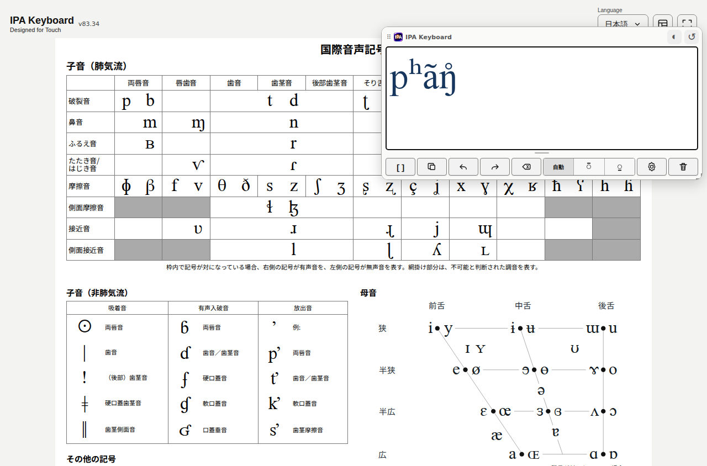
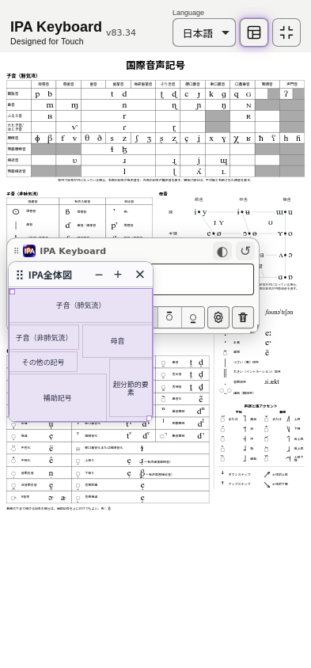

[English](README.md) | [日本語](README.ja.md)

# IPA Keyboard by esaKITs

*Designed for Touch*

A multilingual International Phonetic Alphabet (IPA) keyboard for phonetics teaching, learning and transcription. Select symbols from an interactive chart, compose Unicode text in a floating editor, and copy it into your materials.

[Open the official website](https://esakits.github.io/ipa-keyboard/) · [Reviewed preview](https://esakits-ipa-phase3-20261126.esakit.chatgpt.site/)

> **Review draft** — This README describes the reviewed v83.34 candidate at commit [`34b79b4`](https://github.com/esaKITs/ipa-keyboard/commit/34b79b411654fc866b8faee61e00eb393b795485). The improvements remain on a development branch. The official website serves the published release. The preview requires an authorized ChatGPT account.

## Designed for Touch

The chart is the input surface. Touch feedback and symbol popups help users select IPA symbols, while a movable editor keeps the result close to the part of the chart they are using. Mouse operation is also available.

## Features

- Interactive consonant, vowel, diacritic, suprasegmental and tone symbols, including combining marks.
- Selection feedback and symbol information popups. Light and dark display modes.
- A movable, resizable floating editor. Resizing the panel keeps the text size unchanged, and changing text size adjusts the panel automatically.
- Chart zoom and navigation through a fixed-size overview map. The map and editor can cross and overlap, with the window being used brought to the front.
- Doulos SIL and Andika font choices, adjustable input text size and color, Undo/Redo, brackets, deletion and clear controls.
- Copying of the original Unicode text for use in documents, slides and teaching materials.
- Japanese, English, Brazilian Portuguese and Persian interfaces, plus an Osaka Japanese variant.

## How to use

1. Open the website and choose a display language from **Language**.
2. Tap or click a chart symbol to insert it at the editor cursor. Add combining diacritics to the relevant base symbol. Use Undo/Redo to revise your input.
3. Drag the editor header to move it. Resize its edges or corners independently of text size. Open the gear button to change font, text size or text color. The half-circle button switches light and dark modes.
4. Use the expand button in the header for an enlarged chart, and the overview button beside **Language** to show its map. Drag the pale purple viewport rectangle to pan. Make that rectangle smaller to zoom in, or larger to zoom out. The map frame stays the same size. Drag the map header to move the window, including across the editor.
5. Press the copy button, then paste into your document or slide. Choose an IPA-capable font in the destination application, such as Doulos SIL or Andika.

Copying preserves Unicode characters. Font, color, size and display-only diacritic positioning are not included in plain-text copying. Glyph shapes and combining-mark placement depend on the destination font and application.

## Screenshots

These images come from the verified v83.34 candidate cited above. Both show the Japanese interface.

### Desktop layout

Chromium, 1280 px viewport width, light mode, enlarged input text.

### Phone layout

WebKit, 393 px viewport width, light mode. The overview map overlaps the editor during the window-crossing check.

## Verified environments

| Check | Coverage |
| --- | --- |
| Browser engines | Automated Chromium and WebKit runs |
| Layout widths | 320, 375, 393, 768 and 1280 CSS pixels |
| Display modes | Light and dark, normal and enlarged chart |
| Interface variants | Japanese, English, Brazilian Portuguese, Persian and Osaka Japanese |
| Related regression checks | IPA input, editor controls and gestures, text size, zoom/map linkage, window crossing, focus, Undo/Redo |

Phone layouts were tested through browser emulation. Touch dragging was exercised through Chromium's touch emulation at phone widths. These checks do not establish native iPhone Safari or Android browser compatibility. Physical-device testing was not part of the recorded automated suite.

See the [floating-window verification report](https://github.com/esaKITs/ipa-keyboard/blob/work/floating-evidence-20261126/qa/evidence/floating-fix-20261126/REPORT.md) and its [successful GitHub Actions run](https://github.com/esaKITs/ipa-keyboard/actions/runs/45803750494) for evidence and limitations.

## Developer, credits and licenses

Developed by **Tetsuya Esaki, University of Yamanashi**, as part of **esaKITs — Enhanced Smart AI Kits**. © 2026 Tetsuya Esaki / esaKITs.

Based on the [IPA Unicode Keyboard by Weston Ruter](https://github.com/westonruter/ipa-chart), © 2004–2006 Weston Ruter. IPA chart materials are credited to the International Phonetic Association. The association does not endorse this application.

| Material | Existing license |
| --- | --- |
| Software | [MIT License](LICENSE-MIT.txt) |
| IPA chart content and adaptations | [CC BY-SA 4.0](https://creativecommons.org/licenses/by-sa/4.0/) |
| Doulos SIL, Andika and Noto Sans JP fonts | SIL Open Font License 1.1 |

See [CREDITS.md](CREDITS.md) for source attribution, modification notices and individual font license links.
