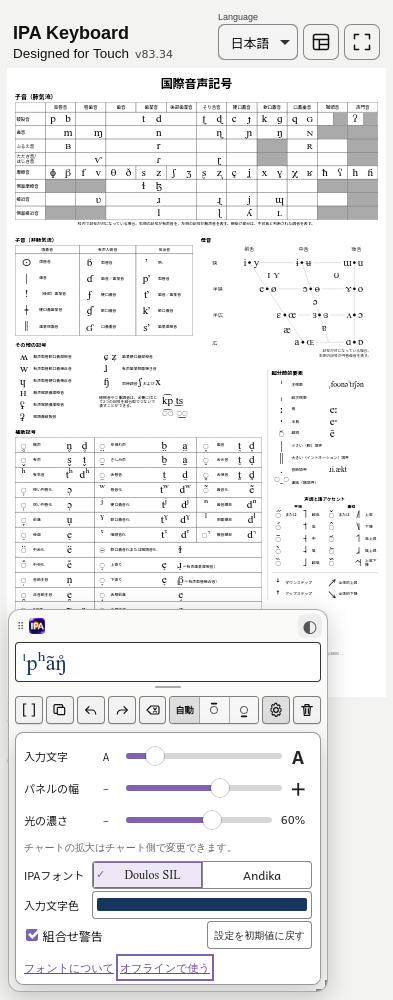
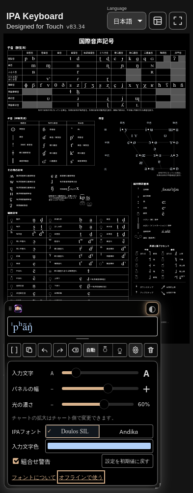

# 角括弧の字形の中央揃えとヘッダー右寄せ

表示バージョン：v83.34。
開始前：e1917e0796a937b1512626ef1172c079393f06af。
作業ブランチ：work/bracket-header-20261128。
開始前バックアップ：backup/before-bracket-icon-20261128。
実装：0afac47c9172ff5638a0afa06723160e8fb1f684。

## 変更

- index.html の［ ］ボタンをフォント文字からSVGへ置換。viewBoxの中心12,12と実際の線の外接矩形の中心12,12が一致する。ボタン内でSVGの中心を上下左右中央へ揃える。
- 既存のボタン幅・高さ・入力処理・id・多言語のtitle/aria-labelは維持。SVGはaria-hidden。
- ヘッダーの言語選択・全体図・拡大縮小のグループを右端へ寄せる（言語選択の左側の余白をauto）。タイトルの2行配置、文字幅、バージョン番号は維持。
- その他のアプリファイル、フォント、配色は変更しない。

## 検証

CI：https://github.com/esaKITs/ipa-keyboard/actions/runs/46031587971
Chromium/WebKit × 320/393/768/1280px × 全5言語 × 白黒で、SVGの中心/ボタンの中心と字形の中心が一致すること、右端のボタンとヘッダー右内端の差が1px未満であることを検査。既存のフォント選択、タイトルの文字幅一致、設定・ダイアログの動作も確認する。
ダイアログの色・設定保持・キャンセル時の文字保持も2ブラウザ・320/393/1280px・5言語・白黒で再検証。
実機は未検証。

確認用：https://esakits-ipa-phase3-20261126.esakit.chatgpt.site
本番main・公開サイトは変更しない。
復元方法：バックアップブランチのコミットから別ブランチを作成する。

## 結果

run 46031587971 成功。角括弧のSVG中心・線の外接矩形の中心・ボタン中心と、ヘッダー右端の一致を全対象環境で確認。画像も確認した。
検証後復元点：backup/after-bracket-header-verified-20261128 → 0afac47c9172ff5638a0afa06723160e8fb1f684。
確認用配信ファイルは検証コミットと一致。配信完了は別途区別する。

