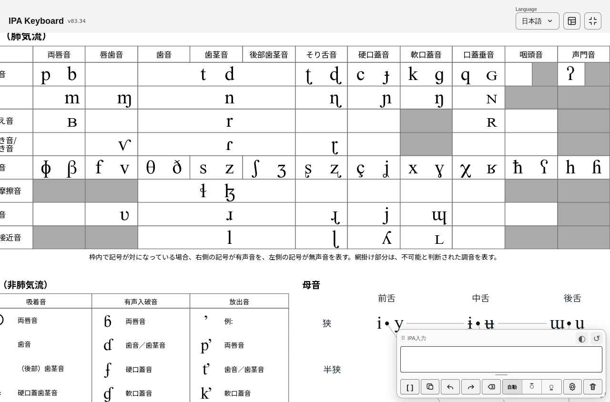
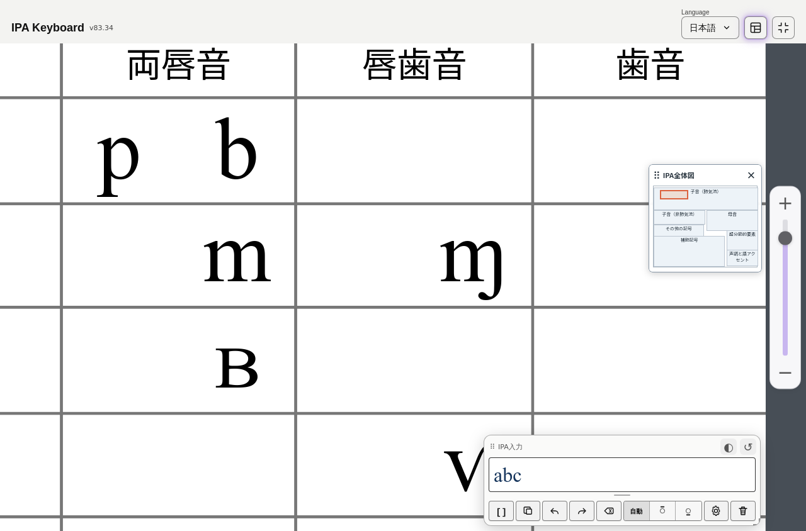
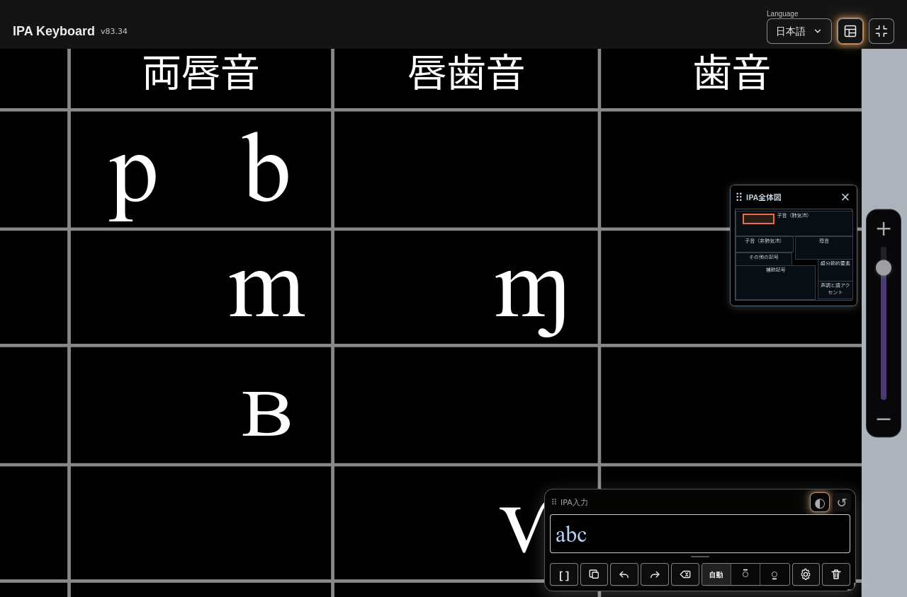
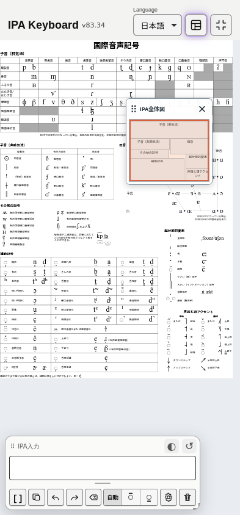

# IPA Keyboard: desktop zoom recovery — 2026-11-20 (JST)

Status: COMPLETE within the automated coverage below. Staged checks, Pages deployment,
main-branch live checks and the independent live runner all succeeded. No known
application failure remains within that coverage. Physical-device limits are listed below.

## Source and preservation

- Displayed version: v83.34 (unchanged).
- Production at start: `368de87ec2a223f048bd73241e51c1074f2f3c07`.
- Independent remote backup: `backup/before-desktop-zoom-20261120-368de87`.
- Work branch: `work/desktop-zoom-20261120`.
- Candidate: `c4e8a2045f4d30ee0ccea736e1d29ad4d15e8df8`.
- Application files changed: `chart.html`, `index.html`.
- Validation files changed: `qa/desktop-zoom.cjs`, `.github/workflows/release-production.yml`.
- Existing regression tests were retained without reducing assertions.
- Original IPA chart markup, ordinary-view gesture source, parent head/SEO metadata,
  translation files, fonts, licenses and Google verification file were preserved.

## Reproduced causes

The immutable starting production commit is served separately in the same Actions job.
Both Chromium and WebKit reproduce these problems:

1. Ctrl +/- has no chart-only shortcut handler. It does not change the chart transform.
2. Desktop Safari-style cumulative GestureEvent input has no chart zoom handler.
3. The expanded desktop chart begins narrower than the viewport. Its required horizontal
   scroll is clamped when zoom begins, moving the intended pointer anchor.

For a native Ctrl-wheel operation on the preserved baseline, chart scale changes from
1 to approximately 1.27125 while the intended anchor moves horizontally by 103.824 CSS px.
Vertical differences are -0.175 px in Chromium and +0.825 px in WebKit.
These measurements concern automated input, not a physical trackpad recording.

## Implemented behavior

- The expanded desktop viewer has its own right gutter, with a vertical lavender slider,
  plus and minus controls, and no visible numeric zoom display.
- Fine pointer / hover input and at least 600px of width enable that desktop gutter.
  Touch-only portrait and landscape profiles have no visible slider or reserved gutter.
- Zoom ranges from the fit-width view to four times that view.
- Desktop fit width is exact so tiny initial pinches are not clamped by a side gap.
  Touch view fitting retains its prior formula.
- Ctrl +/- works when the mouse is over the chart, including when keyboard focus remains
  in the parent header or editor. Ordinary-view browser shortcuts are unaffected.
- Ctrl/Command-wheel and the cumulative Safari-style gesture path preserve the chart
  coordinate under the mouse. Touch pinch retains its two-finger midpoint handling.
- Wheel line/page units are normalized. Simultaneous Safari gesture and wheel input
  cannot apply the same gesture twice.
- The slider and +/- controls preserve the visible chart centre; the pointer is on the
  control while those controls are used.
- Mouse drag pans the chart; a drag does not insert an IPA symbol.
- Input panel bounds and the overview's draggable bounds exclude the desktop gutter.
- Range inputs remain native keyboard-accessible controls, with existing translations
  reused for accessible labels.

## Verification method

`qa/desktop-zoom.cjs` performs:

- Baseline reproduction in both engines.
- 32 desktop cases: 2 engines x 2 widths (768, 1280) x 4 languages
  (ja, en, pt-BR, fa) x 2 themes.
- Actual keyboard shortcuts and native Ctrl-wheel input.
- Safari-style gesture handler tests using synthetic cumulative scale events, including
  a 1.002 tiny pinch and wheel deduplication.
- Screen-coordinate anchor error under 1.6 CSS px (browser subpixel/scroll rounding).
- Native slider dragging with multiple increasing input events, minimum and maximum,
  actual +/- button clicks and a PageDown centre-preserving zoom.
- Mouse panning without text insertion; text and caret retention; scroll restoration;
  version retention; overview/slider/editor separation; hit testing; page errors.
- Eight touch-only cases: both engines at widths 320, 375, 393, 844, checking the absence
  of a slider and gutter and retained two-touch zoom handlers. This focused touch check
dispatches TouchEvent handlers. Full recovery additionally uses native CDP multi-touch
in Chromium; WebKit multi-touch is tested through dispatched TouchEvent handlers.

The unchanged full regression suite additionally checks the input panel's cold response,
font-linked panel sizing, manual resizing, dragging, vowel geometry, tap glow and popup,
header alignment, five repeated expand/restore cycles, multiple locales and themes,
100 recovery scenarios, symbol insertion and editing, Undo/Redo, editor gestures,
viewer icons, offline cache upgrade and production assets. Offline upgrade is exercised
on the staged server; live runs verify the actual public assets and interactions.

## Execution evidence

- Staged run: https://github.com/esaKITs/ipa-keyboard/actions/runs/44744372516
- Staged desktop-specific gate: passed.
- Staged cold panel responsiveness: passed.
- Full staged result: SUCCESS, exact candidate commit.
- Staged artifacts: https://github.com/esaKITs/ipa-keyboard/actions/runs/44744372516/artifacts/14634010387
- Pages deployment: https://github.com/esaKITs/ipa-keyboard/actions/runs/44746500178 (SUCCESS, candidate commit).
- Live verification: https://github.com/esaKITs/ipa-keyboard/actions/runs/44746500547 (SUCCESS, exact production commit).
- Public artifacts: https://github.com/esaKITs/ipa-keyboard/actions/runs/44746500547/artifacts/14634638184

## Additional live runner

The main-branch live check remained in browser/dependency installation for over ten
minutes, before executing application tests. A separate verification branch was created
to start the same live checks on another runner, without any production code changes.
The first environment subsequently recovered. Both complete live runs succeeded.

- Verification-only commit: `ae7f0b2b50b4927fd34f834157e456a87aad0012`.
- Verification branch: `work/live-desktop-zoom-20261120`.
- Fresh live run: https://github.com/esaKITs/ipa-keyboard/actions/runs/44748170261 (SUCCESS).
- Difference from the production commit: two workflow dispatch/branch-condition lines
  only. Application files and every test command/assertion are identical.
- This run targets `https://esakits.github.io/ipa-keyboard/`, with `PUBLIC_CHECK=1`,
  checks public file bytes against the checked-out source, and executes the full live suite.

## Independently checked public files

All four requests returned HTTP 200, and their response bytes matched the candidate files.
The ordinary index and chart URLs also matched without query parameters. The live Actions
checks independently compared all 15 production assets with the checked-out commit.

| File | Bytes | SHA-256 |
| --- | ---: | --- |
| chart.html | 132932 | ddc3f966a15a913d0c338b4f721a00a8d0c317aaf1b7bf56f3d11b92eed839d8 |
| index.html | 134486 | 19f425dd15ee0777fdd6ebb53202fd6d0417d9bc8d7331ee1866c44d62d5fb9a |
| sitemap.xml | 174 | 6fa9936677e98187bd5a23648b94ee8b7137b73e58a2b318813fab4a1d8f9768 |
| google4036f06ded0082a9.html | 53 | 79e2fdee2a2851375f75457f921fef1f56cf45e7b46fe67b0f16455b409526fc |

## Limits

No physical iPhone, Windows precision trackpad, or macOS Safari hardware was operated
in this task. Linux WebKit automation is not a physical Safari trackpad test. Safari's
cumulative gesture handler is verified through dispatched events; native Ctrl-wheel,
keyboard, slider and mouse drag actions are exercised through Playwright.

At chart edges and the minimum/maximum zoom limits, the finite scrollable chart bounds
still apply. The pointer anchor is preserved wherever the required scroll is available;
this does not create blank panning space beyond the chart.

## Screenshots

These are unedited browser captures. They show different operation states and are not
claimed as a pixel-equivalent before/after pair for this intentional desktop UI change.
The full staged artifact contains 176 screenshots; the main live artifact contains 172.

Preserved baseline after native Ctrl-wheel input (WebKit, 1280px):

Public desktop, light theme, after zoom/drag/overview operations (WebKit, 1280px):

Public desktop, dark theme, in the corresponding test state:

Public touch profile in expanded view, with no slider (WebKit, 393px):

