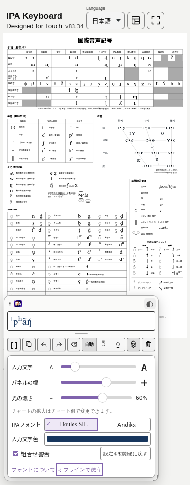
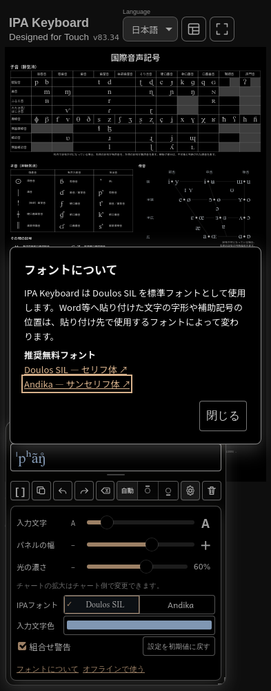
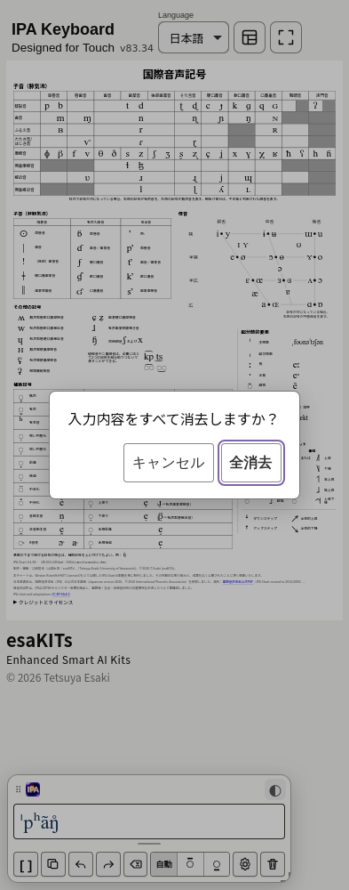

# 案内・確認画面の配色統一

開始前：f39bae16b97a4817854023356ced349f3871478b。
作業ブランチ：work/dialog-colors-20261128。
開始前の復元点：backup/before-dialog-colors-20261128。
対象：index.html のダイアログ限定CSS。リンク・閉じる・キャンセル・全消去・フォーカス枠・タップハイライトの色を統一。

白背景のリンク #6c4b98、フォーカス #8063ad。黒背景は既存の反転フィルターを考慮した #68421c を指定し、画面上は淡いオレンジになる。ボタン文字は #333 を指定し、白背景で濃いグレー、黒背景で明るいグレーになる。
案内本文・見出しの内容、リンク先、ボタン動作、チャート、フォントファイルは変更しない。

推奨無料フォントのリンク先：
- https://software.sil.org/doulos/download/
- https://software.sil.org/andika/download/

両方ともSIL公式のダウンロードページであることを実際に開いて確認。リンクのhrefは修正前後で同一。

CI：https://github.com/esaKITs/ipa-keyboard/actions/runs/46028976786
Chromium/WebKit × 320/393/1280px × 全5言語 × 白黒で、案内2種・全消去確認の色/フォーカス、設定画面の保持、キャンセル時の入力文字列保持を検証。設定・フォント・バージョン配置の既存テストも再実行。
実機は未検証。確認用サイト側の上部×/共有する、下部質問・編集は対象アプリのコード外。
本番mainおよび公開サイトは変更しない。

## タイトル配置の指定変更

依頼に基づき、v83.34をタイトル行からDesigned for Touchの行の右側へ移動。IPA KeyboardとDesigned for Touchの可視文字幅を一致させる。フォント名の文字サイズ12pxは変更しない。
タイトルの実際の幅と同じ書体の計測値からサブタイトルの文字サイズを求める。画面幅・言語によるタイトルのサイズ変化にも追従する。検証ではDOMの文字範囲の実測幅がタイトルと1px未満の差であること、バージョン番号が2行目に収まることを検査。
変更前復元点：backup/before-title-alignment-20261128 → 2e74ba9e78834c6bb14e32d3dc2c3bb678f084da。
配色のみの検証 run 46028976786 は成功。
最終対象：e564174e9ef7feae60fc9d851e81369e20cc421e。
最終CI：https://github.com/esaKITs/ipa-keyboard/actions/runs/46029636892

## 角括弧ボタン

依頼に基づき、#phoneticのみflexで上下左右中央、line-height:1、padding:0に変更。ボタンの幅・高さ、［］を付けるJavaScriptは変更しない。通常・選択・白黒・各言語で中央揃えのスタイルを検証する。
最終対象：e1917e0796a937b1512626ef1172c079393f06af。
最終CI：https://github.com/esaKITs/ipa-keyboard/actions/runs/46029909075

## 完了結果

最終run 46029909075：成功。settings-polish と dialog-colors が完了。
検証後復元点：backup/after-dialog-title-bracket-verified-20261128 → e1917e0796a937b1512626ef1172c079393f06af。
本番mainは391cd42bca752c4772e0e9c77345a25881210401で不変。表示バージョンv83.34は維持。
確認用配信パッケージは検証コミットと同じアプリファイル。更新完了は配信結果と区別する。
確認用URL：https://esakits-ipa-phase3-20261126.esakit.chatgpt.site
今回のアプリ変更は index.html のCSSとタイトル配置・文字幅調整だけ。chart.html、フォント、依存関係、入力操作のJavaScriptは変更しない。

