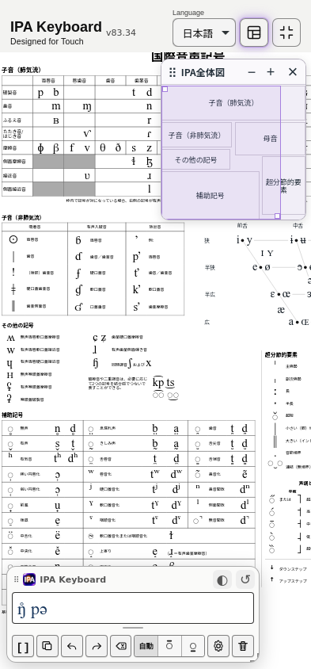
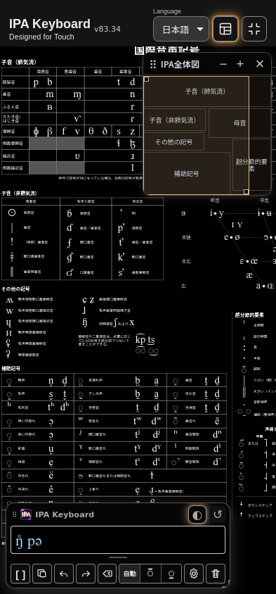
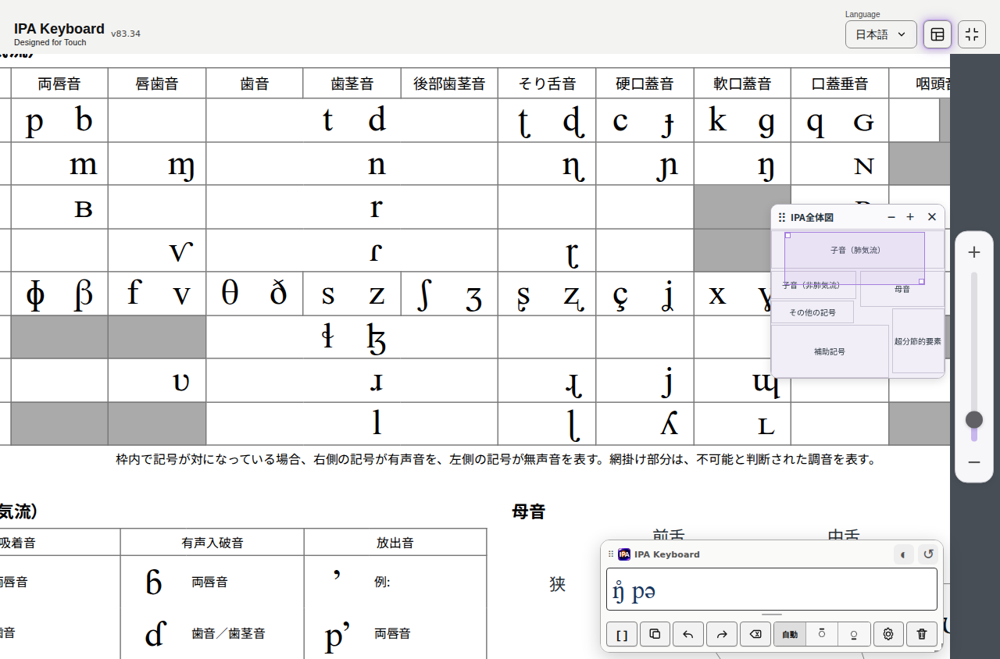
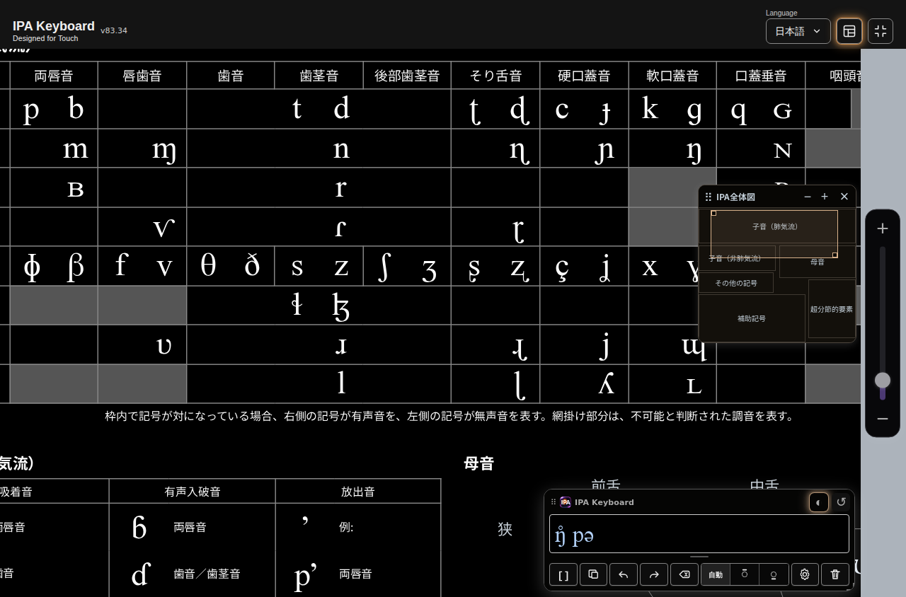

# 初期1.25倍とピンチアウトの拡大モード連動（2026-11-27）

## 対象・復元先

- 表示版：v83.34。
- 開始時本番 main：`ad648a46b0b2bb41b210d6eb695223118dbedf53`。
- 開始前バックアップ：`backup/before-initial-zoom-125-20261127`（上記SHA）。
- 作業ブランチ：`work/initial-zoom-125-20261127`。
- 候補コミット：`acd51a09c03aed00ad4d8115265a86da8bad655e`。
- 本番 main への反映は行っていない。

## 変更した内容

アプリの変更ファイルは `chart.html` のみ。CSSの全styleブロックは修正前と一致し、配色・フォント・ボタン配置・アニメーション・点灯設定に変更はない。

1. 拡大ボタンで開く時の初期倍率を、表示領域に収まる基準の1.25倍にした。ブラウザ側の表示倍率に対する既存の補正と1〜4倍の制限は維持。
2. チャート上のピンチアウト後、従来の通常表示内だけの拡大から、既存の拡大モードへ切り替える。指を離した時点で倍率と対象位置を引き継ぐ。ヘッダーの既存ボタンは既存のモード通知により「通常表示に戻る」へ切り替わる。押すと通常表示へ戻る。
3. SafariのGestureEventとChromium系のCtrl/Meta付きwheelにも同じ入口を設け、チャート内のトラックパッド拡大も復帰ボタンと連動させた。入力パネル上の独立したピンチ・サイズ変更は変更していない。マップボタンだけで通常表示から入る場合の従来1倍も維持した。

ユーザーが追加したピンチ連動の要望に合わせて当初の初期倍率1行変更から範囲が増えた。拡大モード内の既存のスライダー、＋/−、マップ、ドラッグの実装は維持している。

## 検証

[GitHub Actions：3組すべて成功](https://github.com/esaKITs/ipa-keyboard/actions/runs/45983897517)。検証対象 `acd51a09c03aed00ad4d8115265a86da8bad655e`。初期倍率・復帰の100条件が成功し、ピンチアウト／ピンチイン／トラックパッド形式イベント／復帰アイコン／文字列保持／復帰後のIPA入力も成功。既存のデスクトップ拡大操作と入力パネル独立操作の回帰テストも成功。

画像・実測値：`initial-zoom-evidence/results.json`。iPhone実機ではなく、スマートフォン幅のエミュレーション。









初期試行は、スマートフォン幅で非表示のデスクトップ専用ボタンをテストが押そうとして失敗。その後、range要素の既存step=0.001による1.5625→1.563の丸めをテストが許容していなかったため失敗した。また、全幅をタッチ端末として作成したテストではPC専用操作が非表示となったため、PC幅は細かいポインター、スマートフォン幅はタッチ対応のコンテキストに分けた。既存UI・丸め仕様は変えず、検証対象・端末設定・数値許容差を修正した。失敗した実行を成功として扱っていない。

- 新規 `qa/initial-zoom.cjs`：Chromium / WebKit、320 / 375 / 393 / 768 / 1280px、白黒、全5言語の100条件で初期1.25倍、横方向のはみ出し、通常表示への復帰、入力文字列保持、既存の＋/−とマップ倍率操作を検証。
- ピンチのイベントハンドラー、ピンチイン時の非移行、Safari形式ジェスチャー、Ctrl付きwheel、再入場時の初期倍率を検証。ChromiumではCDPによる実際のタッチ入力イベントも使用。
- 既存 `qa/desktop-zoom.cjs`：デスクトップのアンカー、Ctrl+ホイール、スライダー、マップ等の回帰テスト。
- 既存 `qa/editor-gestures.cjs`：入力パネルの独立したピンチ・サイズ変更、Unicode保持、端末別設定の回帰テスト。
- CUAのChromiumで確認サイトを操作し、画面より大きい拡大表示と通常表示への復帰を目視確認。
- JavaScriptの全inline scriptの構文検証に成功。

WebKitの合成ジェスチャーはハンドラー検証であり、Safari実機のタッチ・トラックパッド操作を確認したものではない。iPhone / Android実機は未検証。

## 確認サイト・復元方法

確認用URL：https://esakits-ipa-phase3-20261126.esakit.chatgpt.site

既存の所有者限定サイトを使用し、アクセス範囲は変更しない。配信完了前を更新済みとは報告しない。

復元時は `backup/before-initial-zoom-125-20261127` から作業用ブランチを作成する。本番は未変更のため本番復元作業は不要。

```sh
git fetch origin backup/before-initial-zoom-125-20261127
git switch -c restore/before-initial-zoom-125 FETCH_HEAD
```

検証後の復元ポイント：`backup/after-initial-zoom-125-verified-20261127`。

確認サイト用ソースコミット：`459fd65409f00c18d4da8e1d26d14c2db107542e`。配信対象22ファイルと候補コミットの同一性を照合済み（`initial-zoom-evidence/runtime-hashes.json`）。
