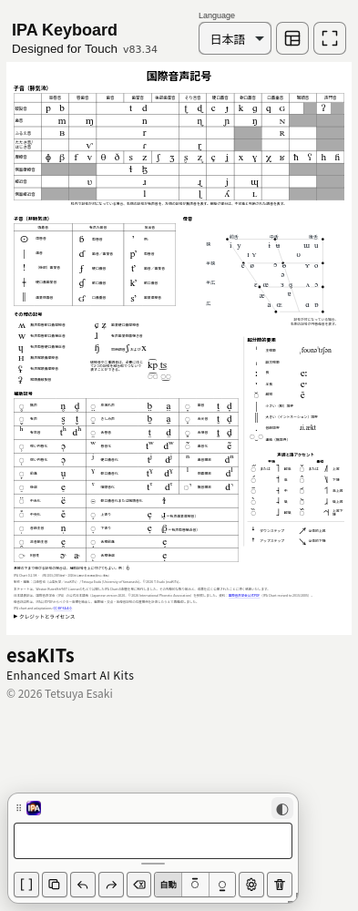
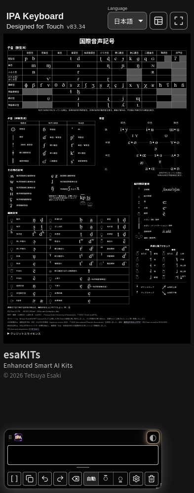

# 入力パネルの6アイコンをLucideへ統一

表示バージョン：v83.34。
開始前：a36784b55bbcc5f0008b88afb2bbbbdc48c49b6f。
開始前復元点：backup/before-lucide-icons-20261128。
作業ブランチ：work/lucide-icons-20261128。
候補：e78afb29030f6e9926e4c4243d4d46e614d427d3。

| ボタン | Lucide SVG |
| --- | --- |
| 1文字削除 | delete |
| 設定 | settings |
| 全消去 | trash（縦線入りゴミ箱） |
| コピー | copy |
| Undo | undo-2 |
| Redo | redo-2 |

## 変更範囲

index.htmlの6つのSVGと、その著作権・ライセンス原文のHTMLコメントだけを変更。ボタンの属性、CSS、JavaScript、配置、大きさ、文字ラベル、残るボタンの図柄は変更していない。qa/lucide-icons.pyで元のSVGへ戻すと開始前のindex.htmlと完全一致することを検査。
SVGはcurrentColorと既存の1.8px線幅を使用。線の形状は公式ファイルと同一。aria-hidden、focusable=falseを指定し、既存の多言語aria-labelを維持。
ライブラリや外部CDNは追加しない。

## 取得元とライセンス

https://github.com/lucide-icons/lucide/tree/4bf621064bed45d114ba31435b85760513830d1c

third_party/lucide/に6ファイルの原本、取得元、ISCとFeather由来アイコンのMITを含む公式LICENSE全文を保存。配信HTMLにもLICENSE全文を保持する。ツール本体のLICENSE-MIT.txtと既存のフォント・チャートのライセンスは変更しない。

## 検証

CI：https://github.com/esaKITs/ipa-keyboard/actions/runs/46049136767
Chromium/WebKit × 320/375/393/768/1280px × 5言語 × 白黒の100通りで、線色・サイズ・太さを確認。変更前後のボタン位置・サイズ・ラベルの完全一致は初期日本語・白背景の10環境で比較。削除/Undo/Redo/コピー/設定/全消去の操作は、各ブラウザ・画面幅の10環境で検査（最後の大阪方言・黒背景の状態）。
コピーはChromiumでは実際のブラウザクリップボードを読み戻し、WebKitではwriteTextへのUnicode文字列の受け渡しを検査する（OSクリップボードの実機検証とは区別）。
実機は未検証。本番main・公開サイトは変更しない。
確認用：https://esakits-ipa-phase3-20261126.esakit.chatgpt.site
復元方法：バックアップブランチのコミットから別ブランチを作成する。

## 結果

run 46049136767：成功。静的比較と両ブラウザの全検証が完了。
検証後復元点：backup/after-lucide-icons-verified-20261128 → e78afb29030f6e9926e4c4243d4d46e614d427d3。
確認用配信対象のアプリファイルは検証コミットと同じ内容。配信完了は別途区別する。
本番mainは391cd42bca752c4772e0e9c77345a25881210401のまま。

[検証結果](lucide-icons-evidence/lucide-results.json)

