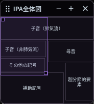
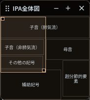
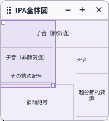

# 黒背景のマップ下地修正（2026-11-27）

- 表示版：v83.34。
- 作業ブランチ：`work/map-orange-20261127`。
- 修正前：`30e93c2eab99768898935183c1d0564a84e54528`。
- 修正・検証対象：`8cd84e49e79a0c702766e3ad63afc9d7cc55012d`。
- 修正前バックアップ：`backup/before-map-base-correction-20261127`。
- 検証後バックアップ：`backup/after-map-base-correction-verified-20261127`。
- 確認サイト用ソース：`eafaed9156ebe7ab4228746ac2845fa460019661`。

## 修正内容と範囲

アプリの変更は `chart.html` 内の黒背景用ナビゲーションマップ CSS だけ。従来は紫の下地に透明度90%の暖色を重ね、内側にも紫味が残っていた。黒背景のマップ本体・ヘッダー・チャート区画・角の□の下地と境界を暖色系へ変更した。既存の反転処理に合わせた変換前の色を使っている。

白背景、言語欄、位置・サイズ、移動、拡大縮小、IPA入力、JavaScript、フォント、依存ライブラリは変更していない。`chart.html` の修正前後を比較し、黒背景のマップ CSS ブロック以外が完全一致することも確認した。

検証用 `qa/map-theme.cjs` は、下地変更に伴う画像比較の期待値を更新し、選択範囲内の最頻実画素が R > G > B の暖色になっていることを確認する処理を追加した。

## 検証

[GitHub Actions：成功](https://github.com/esaKITs/ipa-keyboard/actions/runs/45959191014)。マップ20条件・画像比較8条件・言語欄40条件がすべて成功。黒背景の枠内の最頻画素は両エンジン・全幅で RGB(40,33,25) の暖色。白背景の画像差分は全比較0。CSS切り替えによる選択範囲の位置・寸法の変化はない。

環境：Ubuntu / Playwright 1.61.1 / Chromium・WebKit。320・375・393・768・1280px、白背景・黒背景。スマートフォン幅はエミュレーションであり、iPhone / Android実機は未検証。

- マップの20条件で、枠色、枠内の実画素、拡大操作、矢印によるマップ移動、IPA `p` 入力を検証。
- 393 / 1280pxの計8条件で、同じ live DOM に旧CSS / 新CSSを適用して画像と幾何情報を比較。白背景の画素差は0であることを検証。
- 言語欄40条件を再検証し、前回の白背景＝紫・黒背景＝オレンジの色設定を維持していることを確認。
- 同一画面上の配色比較であり、異なる新規ページ同士の初期配置の一致を保証する検証ではない。

比較画像と実行結果は `map-base-evidence/`、全画像は Actions artifact に保存。







## 確認・復元・本番

[確認サイト](https://esakits-ipa-phase3-20261126.esakit.chatgpt.site)は既存の所有者限定テストサイト。配信完了前を配信済みとは報告しない。本番 main への変更・マージ・公開、GitHub公開情報の変更は行っていない。

修正前へ戻すには以下の復元ポイントから作業用ブランチを作成する。

```sh
git fetch origin backup/before-map-base-correction-20261127
git switch -c restore/before-map-base-correction FETCH_HEAD
```
