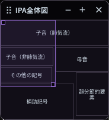
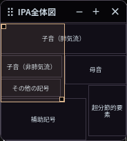
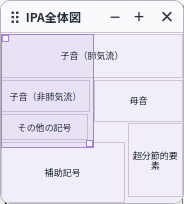
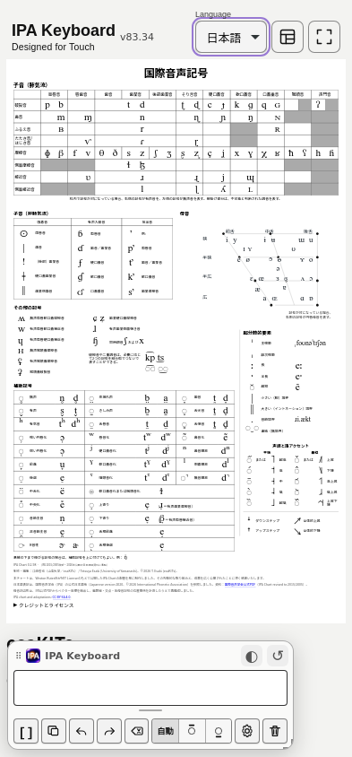
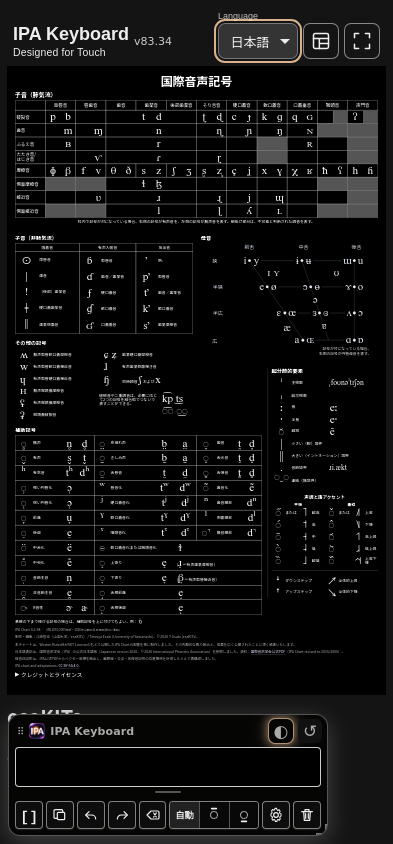
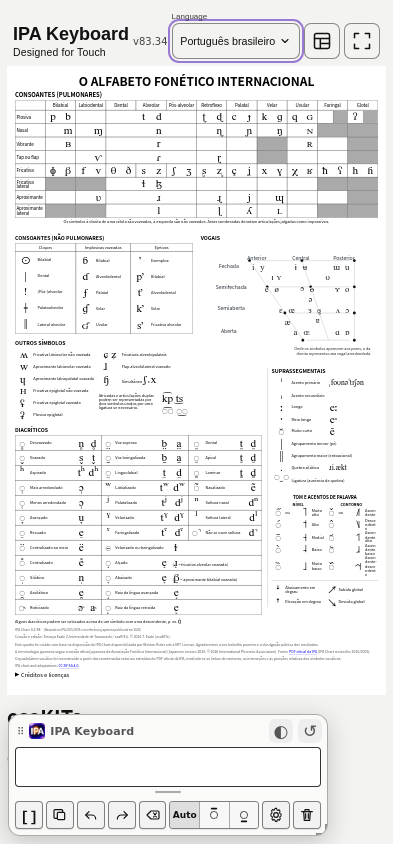
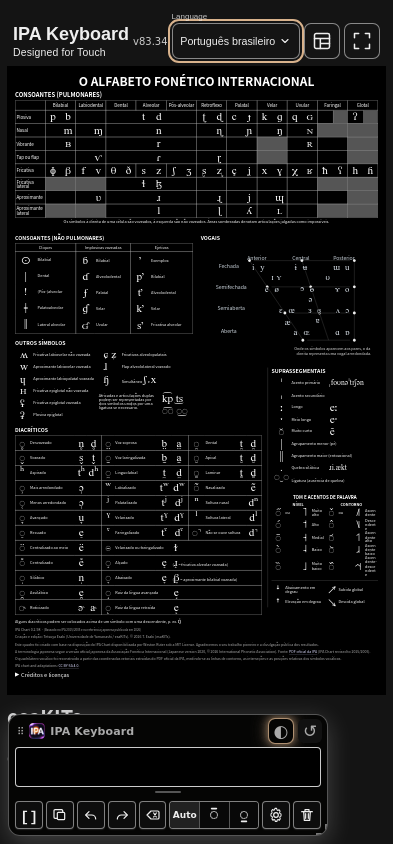

# ナビゲーションマップ・言語選択欄の配色調整（2026-11-27 JST）

## 対象・復元ポイント

- 表示バージョン：v83.34（今回も維持）。
- 作業ブランチ：`work/map-orange-20261127`。
- 開始時の本番 main：`7a96b1917818b0c7ca8d23cd9868fc85f7a242d2`。
- 開始前バックアップ：`backup/before-map-orange-20261127`（上記 SHA）。
- 実装コミット：`370d36e141bd16894d3e9d80a219946d2bf082f8`。
- 最新検証対象コミット：`30e93c2eab99768898935183c1d0564a84e54528`（アプリ配信ファイルは実装コミットと同じ）。
- 確認サイト用ソースコミット：`e9d35c6a618972bd8e4d93566c7d17134528c43e`（別の確認サイト用リポジトリ）。
- main への反映・本番公開・GitHub 公開メタデータの変更は行っていない。

## 原因と変更内容

### 言語によって紫と青が混在する理由

`language-picker.js` は、561px 以上では全言語に独自ボタンを使う。一方、560px 以下ではブラジルポルトガル語だけ独自表示を重ね、ほかの言語は標準の select を表示する。

変更前は独自ボタンにのみ `#9879D3` のフォーカス枠があり、標準 select の枠・タップ色は未指定だった。このため、スマートフォンではブラジルポルトガル語の紫と、それ以外のブラウザ・OS 標準色が混在し得る。依頼者の iPhone で報告された青そのものは実機未計測であり、全端末で必ず青になるという意味ではない。

参考：標準の `outline-style:auto` はプラットフォーム標準表示を許容する（[W3C CSS UI](https://www.w3.org/TR/css-ui-4/#outline-style)）。また、標準 select の内部表示には OS の表示が使われる（[MDN](https://developer.mozilla.org/en-US/docs/Learn_web_development/Extensions/Forms/Customizable_select)）。

### 今回の配色

| 対象 | 白背景 | 黒背景 |
| --- | --- | --- |
| 言語選択欄のフォーカス枠 | `#9879D3`（紫） | `#D8B28C`（薄いオレンジ） |
| 言語選択欄のタップ色 | 同じ紫、透明度25% | 同じオレンジ、透明度25% |
| マップ選択範囲の枠・角の□ | 従来の `#A680DE`（紫）を維持 | 画面上で約 `#D8B28C`（薄いオレンジ） |
| マップ選択範囲の内側 | 従来の紫、透明度10% | オレンジ系、透明度10% |

黒背景のマップは既存の `invert(1) hue-rotate(180deg)` の対象なので、CSS 上では `#68421C` を指定し、フィルター後に薄いオレンジとして表示する。入力パネルの白黒反転ボタンの発光にも使われている変換前の色に合わせた。言語選択欄は反転対象ではないため、表示色 `#D8B28C` を直接指定する。

変更はページ内の言語選択欄の枠・タップ時のフィードバックに限る。スマートフォンの OS が開く選択画面・項目の標準色を独自メニューで置き換える変更はしていない。

### 変更ファイル

- `chart.html`：黒背景の選択範囲の枠・塗り・角の□に限った CSS 3 行。
- `index.html`：言語欄にテーマ別の色変数、標準 select のフォーカス枠、タップ色を設定。独自ボタンとブラジルポルトガル語用表示にも同じ色変数を適用。
- `qa/map-theme.cjs`：実際のブラウザによる色・画像・位置・入力・拡大縮小・言語欄の検証。
- `.github/workflows/map-theme.yml`：候補と変更前 main を別ポートで配信し、Chromium / WebKit で比較。アプリの依存ライブラリは変更していない。
- 本報告、実行結果、スクリーンショット、配信対象ファイルのハッシュ一覧。

移動・拡大縮小・言語切り替えの JavaScript、フォント、配置、SEO、ライセンスに変更はない。

## 検証

結果は `map-theme-evidence/results.json` に保存する。スクリーンショットは同ディレクトリ、および Actions の `map-theme-and-language-focus-evidence` artifact に保存する。

検証環境は Ubuntu 上の Playwright 1.61.1、Chromium / WebKit。画面幅 320 / 375 / 393 / 768 / 1280px、各高さ844px。スマートフォン幅はタッチ対応エミュレーションであり、iPhone・Android 実機ではない。

- マップ：2 エンジン × 5 幅 × 白黒の20条件で、枠・角の□の指定色とスクリーンショットの画素色、拡大ボタン、マップの矢印移動、IPA `p` 入力を確認する。
- 393 / 1280px の計8条件では、同じ候補版 DOM・表示位置に開始時 main のマップ CSS を適用して比較。選択範囲の位置・寸法を比較し、白背景のマップ画像が同じであること、黒背景の変更画素が選択範囲内に収まることを確認する。
- 言語欄：2 エンジン × 393 / 1280px × 全5言語 × 白黒の40条件で、キーボードフォーカスの位置、枠色、タップ色の計算済みスタイル、選択値を確認する。
- ローカル確認サイトを CUA の Chromium で操作し、白背景の紫枠、黒背景のオレンジ枠、黒背景マップのオレンジ表示を目視確認した。独自メニューの実際の各項目をクリックし、全5言語×白黒の10回で選択表示と枠色を確認した。

検証コードはフォント読み込みとマップの位置・寸法の安定を待つ。初回は独立ページ間の位置・寸法比較が一致せず失敗し、その後、非表示の標準 select までフォーカス枠を要求したテストにも失敗した。待機と検証対象を修正した後も、WebKit の独立ページ間で初期表示位置・寸法の差を確認した。この差の原因は本調査では確定していないため、アプリの位置調整には手を加えていない。配色変更そのものの影響は、同じ live DOM・表示位置で変更前 CSS / 変更後 CSS を切り替えて比較する方法とした。失敗した実行を成功として扱っていない。

失敗履歴：[初回](https://github.com/esaKITs/ipa-keyboard/actions/runs/45866724928)、[2回目](https://github.com/esaKITs/ipa-keyboard/actions/runs/45867629006)、[3回目](https://github.com/esaKITs/ipa-keyboard/actions/runs/45867866125)。

### 検証結果：成功

[GitHub Actions（成功）](https://github.com/esaKITs/ipa-keyboard/actions/runs/45868385639) — 実行対象 `30e93c2eab99768898935183c1d0564a84e54528`。

- マップ20条件、画像比較8条件、言語欄40条件すべて成功。
- マップ枠の実画素：白背景は両エンジンとも RGB(166,128,222)、黒背景は RGB(216,178,140)。
- 白背景の変更画素は全4比較で0。黒背景の変更画素は393pxで10,552、1280pxで4,206（両エンジン共通）。選択範囲外の変更画素は全比較で0。
- 同一画面上で CSS を切り替えた際、選択範囲の位置・寸法は全8比較で維持。
- 全40条件で表示中の言語欄の枠色が白背景 `#9879D3` / 黒背景 `#D8B28C`。タップ色の計算済みスタイルもそれぞれ透明度25%で一致。
- マップ拡大、マップ移動、IPA 入力の検証も全20条件で成功。

### 比較画像（WebKit）

393px、黒背景：変更前 → 変更後。同じ表示状態で CSS のみ切り替えた比較。





白背景のマップは従来の紫を維持。



言語選択欄（日本語）：白背景 → 黒背景。





ブラジルポルトガル語も同じ配色。





1280px のマップ比較も同ディレクトリに保存。Chromium を含む全画像は Actions artifact に保存。

## 未検証・制約

- iPhone Safari / Android 実機の操作・一瞬のタップ表示は未検証。
- タップ時の透明色は計算済みスタイルまで検証し、実機で瞬間的に描かれる画素色の保証とは区別する。
- OS 標準の選択メニュー内の色は、OS / ブラウザの仕様による。
- 独立した新規ページ同士で、マップの初期位置・寸法が常に同じであることは確認できていない。今回の配色 CSS の影響は同一画面上で比較した。
- 今回の CSS に関連しない機能全体の再検証は行っていない。

## 確認用サイト・復元方法

確認用サイト：[esaKITs IPA Keyboard](https://esakits-ipa-phase3-20261126.esakit.chatgpt.site)。所有者限定の既存サイトを更新対象とし、アクセス範囲は変更しない。

配信対象22ファイルが実装コミットと一致することをパッケージ作成前に照合した（`map-theme-runtime-hashes.json`）。配信完了前の状態を配信済みとは扱わない。

変更前に戻す場合は、作業用チェックアウトを `backup/before-map-orange-20261127` から作成する。例：

```sh
git fetch origin backup/before-map-orange-20261127
git switch -c restore/map-theme-before FETCH_HEAD
```

検証後の復元ポイントは `backup/after-map-orange-verified-20261127`。本番 main は変更していないため、本番の復元作業は不要。
