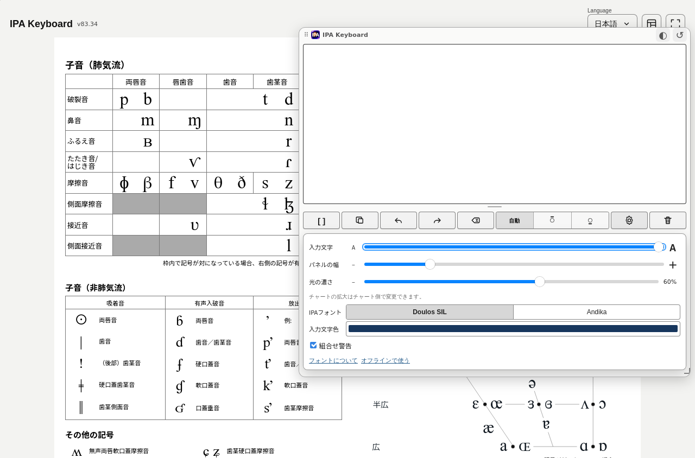
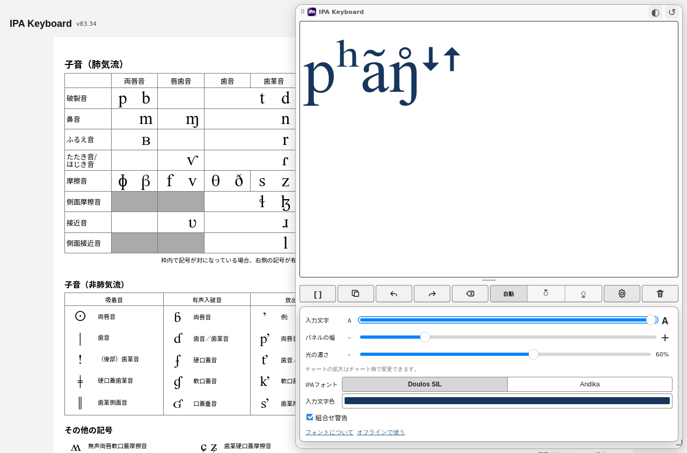
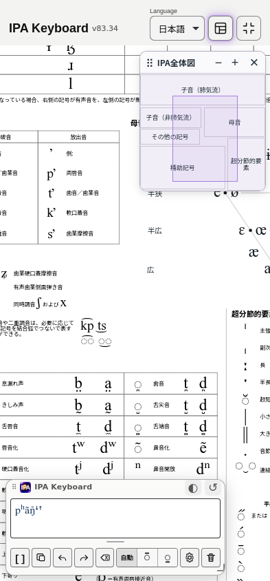
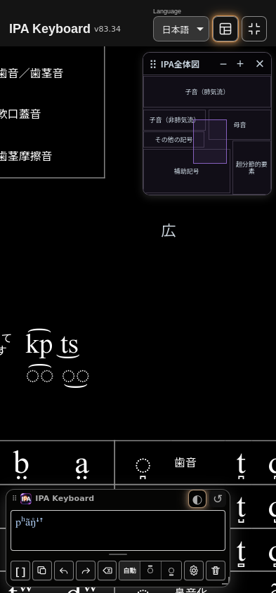
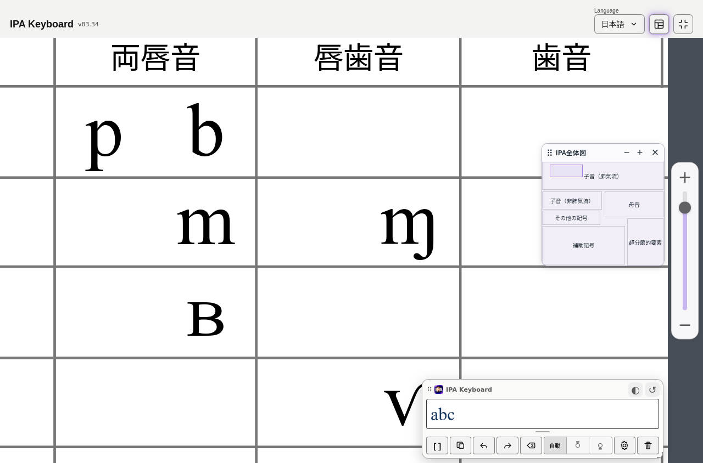

# 第1弾：表示・操作の改善　検証報告

> 訂正：本報告の1-2は依頼内容を誤解した旧候補の記録です。マップ自体の拡大ではなく、薄紫色の□を操作する仕様へ変更しています。[訂正報告](PHASE1_MAP_CORRECTION_20261126.md)を参照してください。旧候補の成功記録は訂正後の仕様の合格証拠にはなりません。

**最終判定：第1弾の実装・自動検証合格。本番未反映。依頼者の確認待ち。**

## 1. 対象・保全・作業範囲

- 表示バージョン：v83.34（画面上の版番号は変更していない。SHAで区別）。
- 開始時の本番main：`1646b6c148f5be0b0f420490b96515fc5839470f`。
- 開始前バックアップ：`backup/before-phase1-20261125-1646b6c`。上記SHAを指す独立ブランチを作成。既存バックアップは変更していない。
- 第1弾の検証対象：`a46f518f6eb5af3fe34bdd1f1a6001d5ba849bee`。
- 作業ブランチ：`work/phase1-display-20261125`。
- 本番URL：[IPA Keyboard](https://esakits.github.io/ipa-keyboard/)。今回の候補を公開していない。
- 第2〜4弾の実装、GitHub公開情報の変更、論文作業は行っていない。第5弾は独立した[調査・提案書](SHARING_OPTIONS_20261125.md)のみで、機能追加なし。

## 2. 3項目の原因・変更・比較

| 項目 | 再現・原因 | 変更 | 検証結果 |
|---|---|---|---|
| 1-1 パネル寸法と文字サイズ | 本番SHAの実ブラウザーで、手動設定の高さ295pxに対して文字を32→120pxにしても高さ295pxのまま。保存された高さに基準文字サイズがなく、最低1行分の高さにしか追従しなかった | 手動高さと基準文字サイズを端末プロファイル別に保存。手動リサイズは文字サイズを変えず、文字サイズ変更時は高さを比例追従させる。画面内上限と1行分の可読高さを守る。スライダー操作中はトラックを固定できる範囲で追従し、指を離すと全追従を適用 | 合格。手動リサイズで文字サイズ不変、拡大・縮小による高さ追従、再読み込み、端末別設定、入力・選択位置維持 |
| 1-2 全体図内部の表示範囲 | 現行の全体図には、枠内だけの倍率変更がなかった。枠の拡大では要求を満たさない | 外枠の寸法を維持し、内部を1〜4倍で変更。見出しの＋／−、Ctrl＋ホイール、2本指ピンチに対応。2本指移動で内部範囲を移動。既存の1本指/ポインタードラッグによるメインチャート移動を維持。図の投影、現在領域の表示、タップの逆変換を同じ座標系で処理 | 合格。外枠固定、内部範囲変更、現在領域の投影とタップ位置、枠の移動・開閉、タップ可能範囲、独立した倍率変更 |
| 1-3 拡大表示の左余白 | 拡大時に実チャートを別ステージへ移し、左上0pxへ絶対配置するため、通常表示の外側余白が失われていた。実測で左端0pxを確認 | 拡大ステージに上下左右8pxの実余白を確保。フィット倍率、ステージ寸法、中心維持、ポインター/ピンチ基点、全体図投影・逆変換をすべてこの原点へ合わせる。高さは丸めたoffsetHeightではなく小数を含むレイアウト値で計算 | 合格。1・2・4倍の四辺余白、実際のスクロール限界、チャートの端の可視性、拡大・縮小基点、パン、全体図ナビゲーション |

既存の手動高さ設定には、最初の適用時の文字サイズを基準として補完する。更新直後に既存のパネルサイズを無条件で変えないための移行処理であり、入力本文は変更しない。

### 追従の計測

両エンジンの旧SHA再現：文字32px/高さ295px → 文字120px/高さ295px（高さが固定）。
管理下Chromeプレビューでの操作後実測：文字16px/高さ54px → 文字120px/高さ405px。文字列コピー・文字色変更・フォント切り替えも実操作で確認。[測定記録](evidence/phase1-20261125/managed-chrome-checks.json)。

最終候補の文字サイズスライダー検証（2エンジン×5幅）：全10件合格。24点すべてで異なる文字サイズが描画され、操作中のトラックずれ最大0px、要求サイズから描画確認まで最大32ms。これはCI環境の計測値であり実機速度の保証ではない。

## 3. 変更ファイル

アプリ本体は次の2ファイルに限定。

- `editor-gestures.js`：手動高さの基準フォント保存、文字サイズに対する高さ追従、操作中のトラック位置維持、操作終了後の追従。
- `chart.html`：拡大ステージ余白と全座標変換、全体図内部倍率・移動・投影、新しい全体図操作ボタン。親ページに移された全体図でも同じ要素参照で動くようにしている。

検証関係：

- `qa/phase1-display.cjs`：旧SHA再現、5幅×5言語×白黒×2エンジン、3倍率、全体図の内部倍率・タップ・ピンチ・逆投影、余白とスクロール限界。
- `qa/editor-gestures.cjs`：旧「手動高さは最低1行分だけ拡大」の期待値を、新仕様の比例追従と画面上限へ更新。文字サイズ不変、ドラッグ、保存などの検査は保持。
- `qa/panel-controls.cjs`：既存の応答性・トラック固定の検査を保持し、スライダーを離した後の完全な比例高さ追従の検査を追加。
- `qa/floating-overview.cjs`：新ボタンを含むTab/Shift+Tab順序を検査。読みやすさ、移動、開閉、入力保持、座標精度の既存検査を保持。
- `qa/desktop-zoom.cjs`：4倍の定義を「実余白16pxを除いたフィット幅」に合わせる。最大値、ポインター基点、ショートカット、パン、端末別UIの検査は保持。
- `.github/workflows/phase1-display.yml`：第1弾専用ブランチだけの検証。独立した検査を並列化。公開・main更新・Pagesデプロイ処理は含まない。

`index.html`、4つのSVG、チャート本文、フォント、翻訳、既存設定処理、サービスワーカーは変更していない。[差分整合性の記録](evidence/phase1-20261125/source-integrity.json)。SEO・README・GitHub Description等も今回変更していない。

## 4. 検証環境と実施結果

[GitHub Actions：最終対象実行](https://github.com/esaKITs/ipa-keyboard/actions/runs/45605133272) — **成功（7/7ジョブ）**。 [実行・ジョブの記録](evidence/phase1-20261125/actions-summary.json)。対象SHA：`a46f518f6eb5af3fe34bdd1f1a6001d5ba849bee`。

ジョブ：phase1 / panel / overview / zoom / geometry / feedback / recovery。検証用のローカルサーバーへ実行しており、本番デプロイは行っていない。

- Playwright 1.61.1 / Chromium・WebKit / Ubuntu CI。アプリ依存ライブラリやフォントの更新なし。
- 幅320・375・393・768・1280px、高さ844px。既存のPC詳細検査では768・1280px、パネル直接操作検査では390・1280pxも使用。
- 日本語・英語・ブラジルポルトガル語・ペルシア語・大阪方言。白背景・黒背景。通常表示・拡大・通常へ復帰。
- 第1弾専用：100組み合わせで実操作し、倍率1・2・4の計300状態の余白・端・スクロールを検査。基準SHAの不具合は両エンジンで再現。
- 全体図の既存回帰：80組み合わせ。文字の収まり、移動、ヘッダーへのユーザー指定移動、開閉・再表示、フォーカス、メインチャートとの座標精度。
- 既存復帰テスト：100シナリオ。入力・カーソル保持、Undo/Redo、代表記号の実入力、文字サイズとパネル、ヘッダー、拡大・ピンチ・パン、表示復帰。
- PC拡大操作：Ctrl＋ホイール、Ctrl＋＋/−、スライダー、Safariジェスチャーハンドラー、マウス移動とチャート移動。スマホではPCスライダーを表示しない既存仕様を維持。
- フォント切り替え、母音28記号・7線の既存配置の同値性、超分節グループ、ポップアップ、発光、白黒反転、アイコンの既存回帰。
- 旧オフラインキャッシュからの更新、フォントとチャートの再利用、入力、無関係なキャッシュの保持。検証サーバーに対する結果であり、本番への公開後検証ではない。
- 第1弾専用の最終結果は全10ブラウザー/幅のエラー配列が空、失敗0件。[生データ](evidence/phase1-20261125/phase1-results.json)。

既存回帰の全計測JSON：[regression-results.zip](evidence/phase1-20261125/regression-results.zip)。GitHub Actionsの各ジョブにも元のスクリーンショットとJSONを保存している。

### 検査を修正した理由

初期候補では、親へ移した新しい全体図ボタンの参照不備と、パネル拡大中のスライダーずれを検出し、アプリ本体で修正した。失敗した候補は完成・公開扱いにしていない。

追加した余白検査にも誤りがあった。チャートが画面に収まり余白が余る場合や、ブラウザーのスクロール領域が枠の境界と少し異なる場合に、表示領域の余白を常に8pxと決めつけていた。枠の四辺は8pxを維持することを直接測り、別途scrollWidth/scrollHeightと実際のスクロール限界から期待値を算出する検査へ修正した。許容誤差を単純に拡大して通過させていない。アプリ本体は`9fb296f22b81d9b94ee676d693df8015af9c1d7a`以降変更していない。

## 5. 画像

### パネルの比較（WebKit・1280px）

文字サイズ120px、設定パネル表示時の例。旧版は空欄、新版は検証用文字列を入力しているので、画素一致の比較ではない。位置の変化と高さ追従は意図された変更。

変更前：

変更後：

### スマホ幅の例（WebKit・393px）

検証用に文字サイズ16px、チャート拡大状態。初期文字サイズを16pxに変えたわけではない。

### PCの例（WebKit・1280px）

パン途中の拡大表示。右側の既存スライダー、全体図、入力パネルが操作可能な状態を確認。

## 6. 未検証・制約

- **今回の修正版のiPhone実機、iPad実機、実物のトラックパッドは未検証。** 自動ブラウザー検証と区別する。
- ChromiumのピンチはCDPの入力イベント、WebKitのピンチは合成TouchEvent/Safariジェスチャーハンドラーの検証。後者をiPhoneの実ピンチ検証とは報告しない。新しい全体図ボタンはスマホ幅でPlaywrightのタップも実施。
- 入力文字色の変更とOSクリップボードへのコピーの追加手動確認は管理下Chromeで実施。WebKitで同じOSクリップボード往復・文字色操作は今回追加実施していない。フォント切り替えは両エンジンの既存検査でも実施。
- 現行アプリにIPA記号専用の検索UIを確認できず、専用検索機能の操作は未検証。今回の範囲外なので追加・変更していない。
- 全体図を拡大した状態では、内部の一部を表示する。2本指移動または−で範囲を広げて移動できる。現在のメインチャート領域が内部表示範囲と重ならない場合、現在領域の枠もその外へ出る。
- 第2弾の記号サイズ・母音四辺形の精密化は未実施。本報告の「形状維持」は従来版との同値確認であり、公式PDFとの新たな完全一致の判定ではない。
- 一般公開のテストURLは作成していない。管理下のローカルプレビューで操作確認し、検証画像とコードを保存した。本番URLは旧SHAのまま。
- 第5弾の共有・保存案は調査のみ。OS共有・URL復元・ファイル/画像/PDF保存の実装・動作検証は未実施。

## 7. 復元方法と次の承認

本番に変更していないため、本番の復元操作は不要。テスト版を戻す場合は、`backup/before-phase1-20261125-1646b6c`（SHA `1646b6c148f5be0b0f420490b96515fc5839470f`）から別の作業ブランチを作成すれば、開始前のコードを再現できる。

検証完了後の復元ポイント：`backup/after-phase1-verified-20261125` → `a46f518f6eb5af3fe34bdd1f1a6001d5ba849bee`。開始前と検証済み状態を独立して再現できる。

最終集計時にもmainが `1646b6c148f5be0b0f420490b96515fc5839470f` のままであることをGitHub APIで確認した。証拠・報告書は `work/phase1-evidence-20261125` に分離し、検証対象のアプリコードを変更していない。

第1弾の確認を得るまでは第2弾に進まない。mainへの反映・本番公開は、別途の明示的な許可を待つ。GitHubの公開情報も変更していない。
