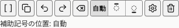

# 自動・上指定・下指定の視認性

表示：v83.34。開始前：e78afb29030f6e9926e4c4243d4d46e614d427d3。
作業ブランチ：work/placement-clarity-20261128。
復元点：backup/before-placement-clarity-20261128。
最終対象：1dee9f8ed6860d6fe88c9d46c1868e9afb10f44e。

- 「自動」は文字のまま、スマートフォン9→11px、PC10→12px。
- ペルシア語の長いラベルは一部幅ではみ出したため従来サイズ（9/10px）を維持。日本語・英語・ブラジルポルトガル語・大阪方言は拡大。
- 上下アイコンは16→18px。半透明65%の細かい破線を、濃さ100%の独立した8個の丸い点へ変更。
- 点の半径0.8（viewBox 20）・円周半径4.4。上または下の線は線幅2→2.2。
- ボタン寸法・配置、全JavaScript、選択方法は変更しない。アプリ変更はindex.htmlだけ。

## 検証

最初のrun 46092569869：375pxペルシア語でラベル33pxに対して表示幅29pxとなり検査停止。その言語だけ従来サイズへ戻す修正。
最終CI：https://github.com/esaKITs/ipa-keyboard/actions/runs/46092787677
Chromium/WebKit × 320/375/393/768/1280px × 全5言語 × 白黒の100通りで文字がボタン内に収まること、点が16個（8×2）・不透明であること、3モードの切り替えを確認する。
実機は未検証。

確認用：https://esakits-ipa-phase3-20261126.esakit.chatgpt.site
本番main・公開サイトは変更しない。
復元はバックアップブランチのコミットから別ブランチを作成する。

2回目run 46092787677：WebKit 375px英語Autoでラベル31pxに対し表示幅29pxとなったため停止。文字サイズを保ち、Autoボタン内部の左右パディングだけを0にして改善。外寸は変更しない。
最終対象：57782455a2bfeec569416dcf30d1f880f89b0785。

最終仕様：文字拡大は日本語・大阪方言に限定。他の言語は従来の9/10pxと従来のパディングを維持。
3回目run 46093043448でWebKit英語の寸法を確認し、余白を変更せず日本語だけ拡大する方針に修正。
4回目run 46093271431ではWebKitペルシア語が従来の9pxでもはみ出すことが見つかった。変更前a36784b55bbcc5f0008b88afb2bbbbdc48c49b6fも同じブラウザで実測し、既存問題かを比較する検証に変更。関連しない翻訳やレイアウトの修正は追加しない。
アプリ実装：8c335e6d3515fc42e07cd4cd33626f0111b00553。
最終検証対象：7d7a1a862b55f8284fe5990db40f6f8ce2d3e5ec（QAのみ追記、アプリファイル同一）。

## 最終結果

run 46093468606：成功。2ブラウザ×5幅×5言語×白黒の100通りで、点の不透明度・個数・モード切り替えを確認。
日本語・大阪方言の自動ラベルは11/12px、他言語は従来の9/10px。日本語・英語・ポルトガル語は表示幅内に収まる。
WebKit 375/393pxのペルシア語は、変更前・変更後ともscrollWidth33px/clientWidth29px（4px超過）で同じ。この既存問題の改善は今回の範囲に含めず残存問題として報告する。
変更前比較にはa36784b55bbcc5f0008b88afb2bbbbdc48c49b6fを使用。同コミットと開始前e78afb29030f6e9926e4c4243d4d46e614d427d3のplacement部分・CSS・JSは同一（差は別ボタンの6SVGとライセンスコメント）。
検証後復元点：backup/after-placement-clarity-verified-20261128 → 7d7a1a862b55f8284fe5990db40f6f8ce2d3e5ec。
配信するindex.htmlは検証対象と同一。本番mainは391cd42bca752c4772e0e9c77345a25881210401のまま。
確認用サイトの配信完了は別途区別する。

