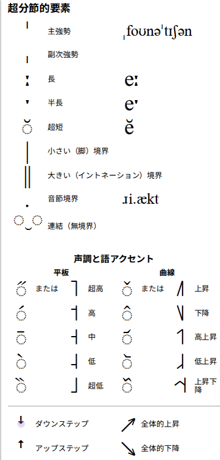
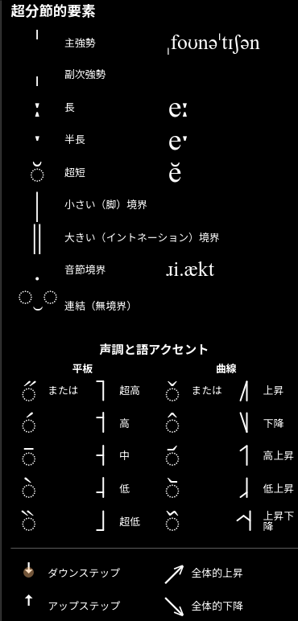

# IPA Keyboard：ダウンステップ・アップステップのUnicode差し替え

2026年11月22日（日本時間）。差し替え・公開・公開URL上の自動検証まで実施。

## バージョンと保全

- 表示版：v83.34（維持）
- 変更前：`fd6345e2bb50c878fff0081ea8955cea246a9b0e`
- 公開コミット：`1646b6c148f5be0b0f420490b96515fc5839470f`
- 独立バックアップ：`backup/before-raised-pitch-arrows-20261121-fd6345e`（変更前と同じSHA）
- 作業ブランチ：`work/raised-pitch-arrows-20261121`
- 公開URL：https://esakits.github.io/ipa-keyboard/

## 差し替え

| 項目 | 変更前 | 変更後 | IPA番号 |
| --- | --- | --- | --- |
| ダウンステップ | ↓ U+2193 | ꜜ U+A71C MODIFIER LETTER RAISED DOWN ARROW | 517 |
| アップステップ | ↑ U+2191 | ꜛ U+A71B MODIFIER LETTER RAISED UP ARROW | 518 |

根拠は[IPA公式の記号一覧PDF・13ページ](https://www.internationalphoneticassociation.org/IPAcharts/common_files/pdfs/pdfs_IPA_charts_E/IPA_Kiel_sl.pdf#page=13)。[公式入力ページ](https://www.internationalphoneticassociation.org/IPAcharts/IPA_charts_TI/IPA_charts_TI.html)にも同じ文字がある。

本体の変更は `chart.html:1620` と `chart.html:1627` の2セルの文字とUnicode説明だけ。CSSの上付き加工は追加せず、専用文字そのものを入力する。CSSのfont-sizeは従来の32pxのまま。専用字形によって矢印が小さく基線より上に描画される。

既存のCSS・JavaScript・フォント・レイアウト・翻訳・バージョン表示は変更なし。↗ U+2197／↘ U+2198、超分節的要素の3群の構成も維持。

## 変更ファイル

- `chart.html`：上記2セルだけ。基準SHAに2つの完全一致置換を加えた結果と、ファイル全体が一致することを確認。
- `qa/suprasegmental-grouping.cjs`：新しいUnicodeに期待値を更新。両フォントの実描画を測定し、字形の全体が基線より上にあり、高さが通常矢印の60%未満であることを追加検証。既存の操作・配置・言語の検査は維持。
- `.github/workflows/release-production.yml`：今回の作業ブランチを既存の公開前検証に追加。テストの削除・検査条件の緩和なし。

## 公開前の検証

[Actions 44915590361](https://github.com/esaKITs/ipa-keyboard/actions/runs/44915590361) — **成功**。

- Chromium／WebKit × 幅320・375・393・768・1280px × 日本語・英語・ブラジルポルトガル語・ペルシア語 × 白黒背景：専用80条件が合格。
- 実入力の文字列が `aꜜ↗ꜛ↘` であり、対応コードポイントが `A71C / 2197 / A71B / 2198` であることを確認。
- 4記号のキーボード入力、Undo／Redo、浮動パネルを実際に移動してからのヒット判定・実クリック、拡大／通常表示への復帰、編集保持が合格。
- 全235入力対象と見出しの階層を維持。HTMLのsup要素で上付きにしていないことも検証。
- Doulos SIL／Andikaのフォントファイルを直接読み、両文字の収録と字形境界を確認。実測値と元フォントのハッシュを `font-bounds.json` に保存。
- ブラウザーでは描画画素のアルファ値を測定。精度確保のため検査用Canvasだけ128pxで描画した。実画面の32pxは変更していない。
- 128pxでの矢印の描画高さは48px、通常矢印は107〜112px。字形下端は基線より42〜46px上。両ブラウザー・両フォントで合格。
- 全体図、PC拡大、パネル初回応答、復帰100条件、母音同等性16条件、ヘッダー、発光、拡大復帰の連続操作、編集ジェスチャー、アイコン、本番資産と旧オフラインキャッシュからの更新の既存テストも合格。

公開前成果物：`14711639840`。ZIP SHA-256：`8a31b67c367c0c04f2edd1c8aac6e0303fd774781673348abd3ef4dd46bb72a2`。

### 初回検証の切り分け

初回実行44915302344ではChromiumの全画面幅が合格した一方、WebKitのCanvas TextMetricsが上付き文字の負のdescentを0として返し、字形の位置・高さの検査が不合格になった。フォントファイルの実測値と照合したうえで、計測APIの値ではなく実際の描画画素を両ブラウザーで測る方法に修正した。「基線より上」「通常矢印の60%未満」の基準は維持。本体に追加変更は加えていない。最終公開前検証の成功を確認してからmainを更新した。

## 公開と公開後検証

[GitHub Pages 44934419495](https://github.com/esaKITs/ipa-keyboard/actions/runs/44934419495) — **成功**。

[公開URL検証 44934419918](https://github.com/esaKITs/ipa-keyboard/actions/runs/44934419918) — **成功**。

公開された16ファイルが対象コミットとバイト単位で一致する検査が合格。公開URL上でも専用80条件（両ブラウザー・5画面幅・4言語・白黒両背景）がすべて合格し、実際の入力文字と描画字形を確認した。復帰100条件、全体図・PC拡大・パネル・母音同等性・ヘッダー・発光・編集ジェスチャー・アイコン・本番資産の既存テストも合格。検証範囲内の未処理JavaScriptエラーはなし。終了後にmainのSHAを再取得し、上記公開コミットと一致することを確認。

公開後成果物：`14719702744`。ZIP SHA-256：`798c23ad1e85ab16d333988b3b9ef7f190f42b03f29b1f633376920f5fe90221`。

[実測結果と資産ハッシュ](evidence/raised-pitch-arrows-20261122/results.json)／[公開後80条件の全結果](evidence/raised-pitch-arrows-20261122/public/suprasegmental-grouping-results.json)／[フォントファイルの字形実測](evidence/raised-pitch-arrows-20261122/font-bounds.json)

### 公開後の画像

## 未検証範囲

今回の変更の実機iPhone Safari検証は未実施。WebKitは自動ブラウザーでの検証であり、実機確認とは区別する。既存のピンチ検査では、ChromiumはCDPのタッチ注入、WebKitはPlaywrightでネイティブ複数指注入が利用できないためTouchEventハンドラーへの合成イベントを使用。通常タップとポインター操作による検査も実行した。
