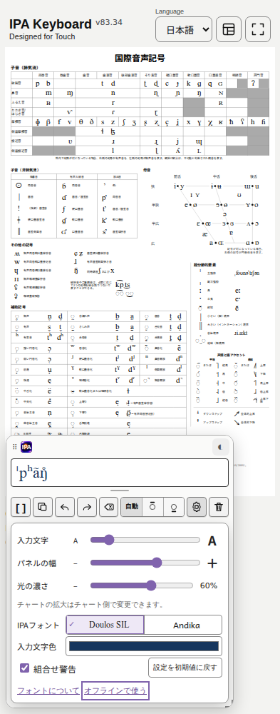
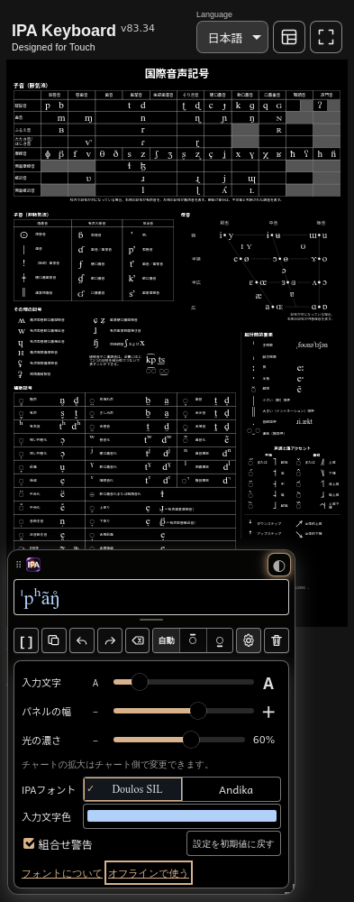
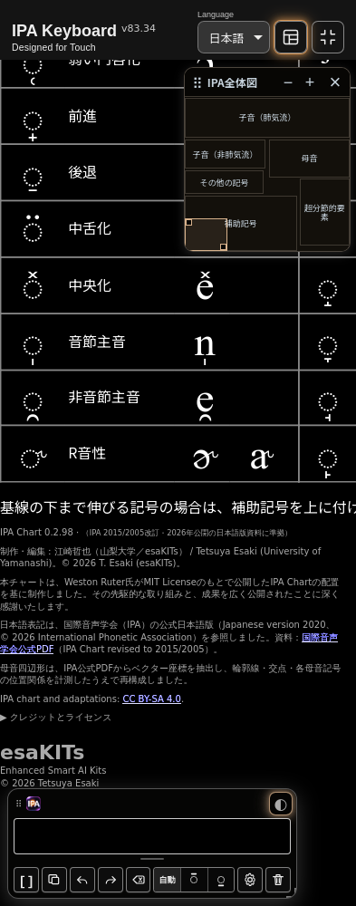

# 設定画面の整理（2026-11-28）

対象：v83.34、work/settings-polish-20261128。
開始前：6008658f02abc0da3ba0dfb009fe7a27edafb4b0。
バックアップ：backup/before-settings-polish-20261128。
実装：afdf8fd7149edda2cc545fbb3ae27041aa6b64bd（初回 3f9f970065482f989f3cec279b4171646a4f5105、フォント選択改善・両ラベル12px固定を追記）。

- リセットを組合せ警告の行の右端へ移し、文字を10pxに縮小。
- 設定のスライダー・チェックを白背景で落ち着いた紫 #8063ad、リンクを #6c4b98 に変更。
- 黒背景ではパネル全体の既存反転フィルターを考慮し、指定値 #68421c を使用。画面上では淡いオレンジとなる。文字は既存のグレーを維持。入力文字色の設定は変更しない。
- 設定外クリック判定とEsc判定が情報ダイアログの操作を拾っていた。fontInfoDialog / offlineInfoDialog が開いている間は設定の閉じる処理を行わない。
- アプリの変更ファイル：index.html と chart.html。専用検証 qa/settings-polish.cjs、qa/viewer-footer.cjs と検証ワークフローも更新。
- フォント名をそれぞれの書体で表示。両方12px・通常の太さで、選択中のみチェックと背景・枠色で区別。見本行は追加しない。未選択のAndikaも名前表示用に読み込む。既存フォントファイル・ライブラリは変更しない。

CI：https://github.com/esaKITs/ipa-keyboard/actions/runs/46025357700
設定リセットの既存検証、およびChromium/WebKit、320/393/768/1280px、5言語、白黒双方で案内2種の閉じるボタン/Escと設定維持、配色、リセット配置を確認する。

最終結果は完了後に追記。
実機未検証。本番main・公開サイトは変更しない。
確認用：https://esakits-ipa-phase3-20261126.esakit.chatgpt.site
復元：開始前または検証後のバックアップブランチから別ブランチを作成する。

初回の配色・配置・ダイアログ修正検証 run 46024825540 は成功。フォント改善後の最終結果は別途確認する。

## 追加された依頼

- v83.34 の前にあった伸縮する余白をなくし、タイトル直後へ寄せる。番号自体は維持。
- 入力パネルはアイコンと移動つまみだけを表示。非表示にする名称のDOMは、既存の翻訳・操作コードが参照するため維持する。
- 拡大時にはチャートだけが移され、その外側の出典説明・ライセンスと親画面のesaKITsロゴが表示対象に含まれていなかった。説明・ライセンスを拡大スクロール領域の下に移し、閉じたときに元の位置へ戻す。ブランド表示は同じ内容を拡大用にも配置する。
- footer の高さをスクロール範囲に含め、下端を入力パネルの上に動かせる余白を維持する。1.25/2/4倍、白黒双方で下端と通常表示への復帰を検証。
- 0.2.98 は内部チャートの番号。削除の許可は未取得なので変更していない。

フォント改善後の初回検証 46025357700 は、テストの属性セレクターがhtmlとbuttonの2要素に一致して停止。buttonに限定して修正した。アプリの設定リセット検証自体は同runでも全10環境成功。
最終検証対象：606437edc8f7a7fbd53d3cba12370cb13b561986。
CI：https://github.com/esaKITs/ipa-keyboard/actions/runs/46026633401

## 最終の見た目確認

606437edc8f7a7fbd53d3cba12370cb13b561986 のrun 46026633401 は成功（設定リセット、配色・フォントとダイアログ、拡大フッター、拡大アイコン）。画像の確認で、反転フィルターに対して黒背景用のロゴ文字色を重複して反転していたことを発見。元の #555 をフィルターで明るく表示するよう修正。リンクのキーボードフォーカス枠もテーマ色に統一。
最終対象：f39bae16b97a4817854023356ced349f3871478b。
最終CI：https://github.com/esaKITs/ipa-keyboard/actions/runs/46027242527

## 最終結果

最終run 46027242527：成功。4スイート（settings-reset / settings-polish / viewer-footer / viewer-icons）が完了。
検証後復元ポイント：backup/after-settings-polish-verified-20261128 → f39bae16b97a4817854023356ced349f3871478b。
本番mainは391cd42bca752c4772e0e9c77345a25881210401のまま。
設定は5言語×白黒×320/393/768/1280pxで検証。設定リセットは375pxも検証。拡大フッターは日本語×白黒×320/393/768/1280px×1.25/2/4倍で到達性と通常表示への復帰を検証。フッターの他言語全組み合わせと実機は未検証。
配信ファイルは検証コミットと同じ内容でパッケージ化済み。確認用サイトの配信完了は別途区別する。

[runtime-hashes.json](settings-polish-evidence/runtime-hashes.json)に変更範囲を記録。すべてのインラインSVGが開始前と同一であることを確認。
