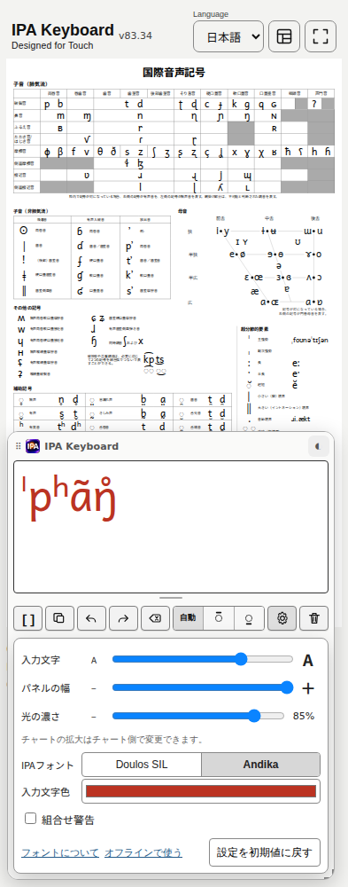
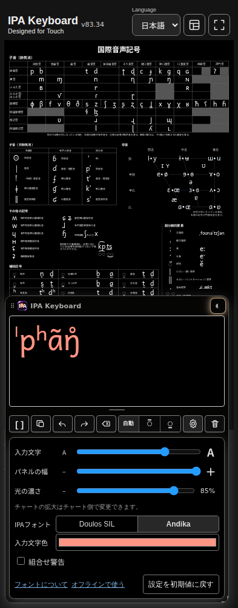

# 設定リセットとヘッダーボタンの整理（2026-11-27）

## 対象と復元点

- 表示バージョン：v83.34（維持）
- 作業開始時の main：391cd42bca752c4772e0e9c77345a25881210401
- 作業ブランチ：work/settings-reset-20261127
- 開始前バックアップ：backup/before-settings-reset-20261127
- 復元：上記バックアップから別ブランチを作成すれば、変更前を再現できる。main は今回の作業で変更しない。

## 実装

1. 入力パネル右上の位置リセットボタンを削除。残る白黒反転ボタンが右端になる。
2. 設定画面の右下に「設定を初期値に戻す」を追加。日本語・英語・ブラジルポルトガル語・ペルシア語・大阪方言の表示に対応。
3. 設定リセットの対象：

| 項目 | 初期値 |
| --- | --- |
| 入力文字サイズ | スマートフォン 22px／PC 32px |
| パネルの基準幅 | スマートフォン 320px／PC 440px（画面幅内に制限） |
| 手動調整した入力領域の高さ | 内容・文字サイズに応じる自動調整に戻す |
| 光の濃さ | 60% |
| IPAフォント | Doulos SIL |
| 入力文字色 | #17365d |
| 組合せ警告 | 有効 |

入力文字列、Undo/Redo、入力中の補助記号の位置設定、言語、白黒モード、チャートの拡大率、パネルの保存位置はリセットしない。文字サイズ・幅・高さについては、現在の端末区分のみを初期化し、もう一方の端末区分の保存設定は保持する。パネルのドラッグとキーボード移動は継続する。サイズ変更による画面内への位置補正は従来通り。

## ファイル

- index.html：上記UIとリセット処理のみ。
- translations.xlsx / translations.csv：新しいボタンの翻訳を1行追加。既存訳は変更しない。
- qa/settings-reset.cjs：2ブラウザ×5画面幅×5言語×白黒の検証、および初期化・入力履歴・保存設定の検証。
- qa内の既存検証：削除ボタンへの参照を、継続するキーボードHome操作または白黒反転ボタンの到達性検査へ変更。
- .github/workflows/settings-reset.yml：本番公開を行わない専用検証。
- runtime-hashes.json：変更範囲を確認するハッシュ比較。chart.html、editor-gestures.js、ipa-fonts.js、i18n.js、language-picker.js、sw.js は変更なし。

## 検証経過

- 構文検査：index.htmlのJavaScript（JSON-LDを除く）、追加テストの構文を検査。
- 翻訳マスター：210行。ExcelとCSVの一致を確認。
- 対話ブラウザ：ローカル確認用サイトで右上・右下の配置、および文字サイズ・光の濃さ・警告のリセットとIPA文字列保持を確認。
- 最初のCI 46013146442：履歴の浅いcheckoutでHEAD~1が取得できず検証前に停止。履歴取得と比較元の指定を修正。アプリの動作不良による停止ではない。
- 2回目のCI 46013474459：大きくした設定パネルのスクロール前の座標を画面内と比較したため、到達性検査で停止。実画面の画像を確認し、パネル内をスクロールして実際にボタンを押せることを検査するよう修正。設定リセット処理自体は変更なし。
- 実装コミット：e59641a4037e23e3419d8523a0b340ef098d20e5。後続コミットは検証コードの整備のみ。
- 検証対象コミット：6008658f02abc0da3ba0dfb009fe7a27edafb4b0。
- 設定リセット検証：GitHub Actions run 46013818707 の verify (settings) が成功。Chromium/WebKit × 320・375・393・768・1280px × 5言語 × 白黒、100通りの配置・翻訳確認、および10環境でリセット動作・入力文字・Undo/Redo・別端末区分の保存設定・再読み込み後の設定を確認。
- 回帰検証：同runの verify (regression) が成功。panel-controls、editor-gestures、tap-feedback、final-four、viewer-icons の5スイートが終了。2ジョブとも成功。
- 検証後の復元ポイント：backup/after-settings-reset-verified-20261127 → 6008658f02abc0da3ba0dfb009fe7a27edafb4b0。
- main は作業終了時も 391cd42bca752c4772e0e9c77345a25881210401 で不変。
- 確認用サイトの配信対象ファイルは検証コミットとバイト単位で一致。配信パッケージは準備済み。配信完了はSitesの結果として別途区別する。

## 確認用URLと証拠

- 確認用サイト：https://esakits-ipa-phase3-20261126.esakit.chatgpt.site （所有者限定のまま維持）
- Actions：https://github.com/esaKITs/ipa-keyboard/actions/runs/46013818707
- 設定の検証値：[settings-reset-results.json](settings-reset-evidence/settings-reset-results.json)
- 配信対象ファイルの比較：[runtime-hashes.json](settings-reset-evidence/runtime-hashes.json)
- Actions成果物 settings-reset-settings-evidence に全35ファイルを保存。

以下は修正後のUIで、初期化前に設定値を変更した状態。旧版の「位置リセット」は右上からなくなり、白黒反転が右端、設定リセットが設定欄の右下にある。

初期化後の文字サイズ22/32px、光60%、フォントdoulos、文字色#17365d、警告ONおよび文字列・履歴保持は検証コードのアサーションと成功ログで確認。上記画像はリセット前なので、光85%・Andika等の変更済み状態を示す。

## 制約

ブラウザ自動検証のスマートフォン表示はエミュレーションであり、iPhone/Android実機検証ではない。実機は未検証。本番 main・公開サイト・リポジトリの公開情報は変更しない。確認用サイトのみに反映する。
