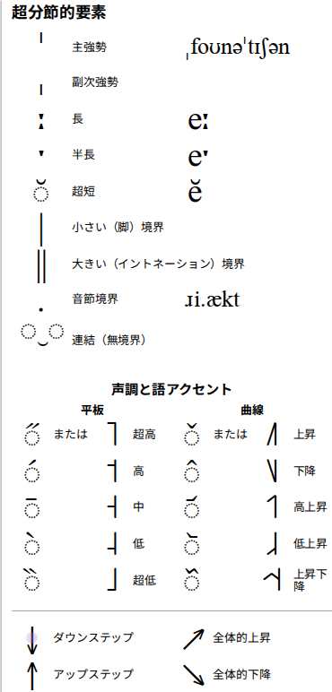
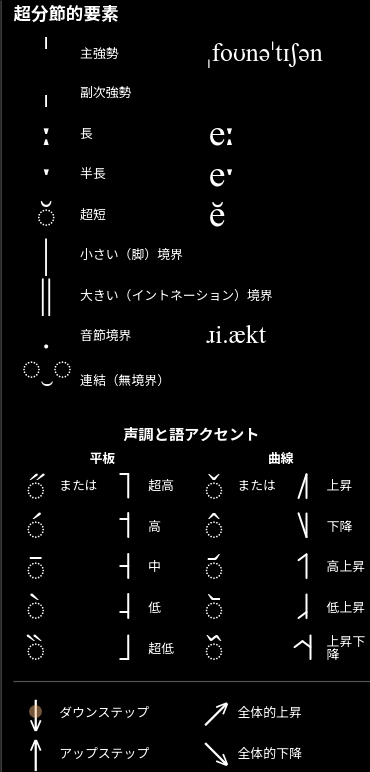
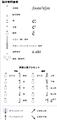

# IPA Keyboard：超分節的要素の階層修正・検証記録

2026年11月21日（日本時間）。修正・公開・公開URL上の自動ブラウザー検証まで実施。

## 対象版と保全

- 表示バージョン：v83.34（変更なし）
- 変更前：`2711356c48299ae7059952592b999830ee54c196`
- 公開コミット：`fd6345e2bb50c878fff0081ea8955cea246a9b0e`
- 独立バックアップ：`backup/before-suprasegmental-grouping-20261121-2711356`（変更前と同じSHA）
- 作業ブランチ：`work/suprasegmental-grouping-20261121`
- 公開URL：https://esakits.github.io/ipa-keyboard/

## 修正内容

「超分節的要素」を次の3群全体の見出しにした。

| 群 | 内容 |
| --- | --- |
| 上段 | 強勢・長さ・境界・連結などの従来の一覧 |
| 中段 | 「声調と語アクセント」の平板／曲線、5行 |
| 下段 | ダウンステップ・アップステップ・全体的上昇・全体的下降 |

変更前は「超分節的要素」と「声調と語アクセント」が並列の見出しで、下の4記号も後者の表に含まれていた。変更後は共通の親要素と全体を貫く区切り線を設け、声調を下位見出しにし、下の4記号を独立した表に分離した。新しい説明文・翻訳語・記号は追加していない。

全体図では、これまで別々だった上段と声調の領域を、4記号まで含む「超分節的要素」一つの領域に統合した。全体図の既存の座標移動、開閉、ドラッグ機能は維持した。

## 変更ファイル

| ファイル | 内容 |
| --- | --- |
| `chart.html:822` | 共通の親要素と区切り線、従来の表幅305pxを維持 |
| `chart.html:1469` | 全体見出しと3群の親子関係 |
| `chart.html:1521` | 声調と語アクセントを下位見出しに変更 |
| `chart.html:1615` | 下の4記号を声調表から分離 |
| `chart.html:1797` | 全体図の対象を共通の親要素に変更 |
| `chart.html:2196` | 移した記号を従来どおり入力対象に登録 |
| `qa/suprasegmental-grouping.cjs` | 80条件の専用テストを追加 |
| `qa/floating-overview.cjs` | 共通親領域を含む正確な6領域を検証するよう更新 |
| `.github/workflows/release-production.yml` | 専用ブランチ・専用テストを追加。公開後に重複していた回帰100条件の2回目の呼び出しだけを除去し、全条件を1回ずつ維持 |

比較対象SHAとの最終差分は上記4ファイルだけ。`index.html`、翻訳ファイル、フォント、母音図、子音表、補助記号、ライセンス、SEOファイル、サービスワーカーは変更していない。

## 公開前の検証

[Actions：44877572105](https://github.com/esaKITs/ipa-keyboard/actions/runs/44877572105) — **成功**。

- 専用80条件：Chromium／WebKit × 幅320・375・393・768・1280px × 日本語・英語・ブラジルポルトガル語・ペルシア語 × 白／黒背景。
- 全体見出しH2、声調の下位見出しH3、3群の包含関係、声調5行・下段2行、下の4記号が声調の表に含まれないことを検証。
- 235入力対象の保持、声調・下段記号の32px維持、翻訳後の横あふれ・群同士の重なりがないことを検証。
- 移した4記号をキーボードで実入力し、Undo／Redoを実行。入力パネルを実際にドラッグして記号を露出し、親ページでのヒット判定後に実ポインターで入力。拡大・通常表示の復帰後も文字を保持。
- 既存テスト：全体図80条件、PC拡大32条件とモバイル操作、パネル初回応答10条件、復帰100条件、母音同等性16条件、ヘッダー配置10組、発光10組、追加4項目10組（各16往復）、編集ジェスチャー、アイコン、公開用資産、旧オフラインキャッシュからの更新が成功。
- 変更前との静的比較：U+のtitle属性を持つ全記号の内容・属性・順番が一致。母音・肺気流子音・非肺気流子音・その他の記号・補助記号のDOMが一致。インラインJavaScript構文と翻訳マスター整合性も合格。
- 保存画像で白黒両背景の3群の配置を確認。

公開前成果物ID：`14697137822`。ZIP SHA-256：`b1cffd69ac23117ba1eab732a6913def4b74671754cfabdafb0ba299db609fc3`。

## 調査・修正履歴

- 初回実装では共通枠の余白により表の内容幅が305pxから294pxになり、あふれ検査が失敗した。親要素をcontent-boxにして従来の内容幅305pxを確保した。検査は緩和していない。
- 新規テストのカーソル位置を明示するよう修正した。
- PCクリック時のポインター記録が空だったケースは、浮動入力パネルが記号を覆っていた。検証手順でパネルをドラッグし、親ページのヒット判定を追加して実クリックを確認した。入力処理を検査に合わせて変更していない。
- 最終候補以外の失敗・取消実行は合格として数えていない。すべて専用ブランチ上で調査し、最終公開前の全テスト成功後にmainを更新した。

## 公開と公開後検証

[GitHub Pages：44878933720](https://github.com/esaKITs/ipa-keyboard/actions/runs/44878933720) — **成功**。

[公開URL検証：44878934041](https://github.com/esaKITs/ipa-keyboard/actions/runs/44878934041) — **成功**。

公開された16ファイルが対象コミットとバイト単位で一致する検査が合格。公開URL上で、専用80条件・全体図80条件・PC拡大・パネル応答・復帰100条件・母音同等性・ヘッダー・発光・追加4項目・編集ジェスチャー・アイコン・本番資産の各テストがすべて合格した。検証範囲内の未処理JavaScriptエラーはなし。終了後にmainを再取得し、公開コミットと同じSHAであることを確認した。

公開後成果物ID：`14697314393`。ZIP SHA-256：`af5ef800b0d352a42e9f7c5f102371582851cb5c11619717d3b2924c8124e28e`。

公開後の実測値は [結果一覧](evidence/suprasegmental-grouping-20261121/results.json) と [専用80条件の全結果](evidence/suprasegmental-grouping-20261121/public/suprasegmental-grouping-results.json) に保存。

保存した3枚を公開前の同条件画像と画素比較した。画像寸法は同じで、選択後の光が表示される13×13pxの範囲だけに差分があり、それ以外の画素は一致した。PNGファイル全体の完全一致とはしていない。

### 公開後のブラウザー画像

## 検証範囲の限界

今回の変更について実機iPhone Safariでの検証は行っていない。WebKitの通常タップはPlaywrightのタッチ操作、全体図のドラッグはポインター操作で検証。WebKitのネイティブ複数指注入はPlaywrightから利用できないため、既存のピンチ検査はTouchEventハンドラーへの合成イベントによる。Chromiumの複数指操作はCDP経由で検証している。自動ブラウザー検証と実機検証を区別する。
