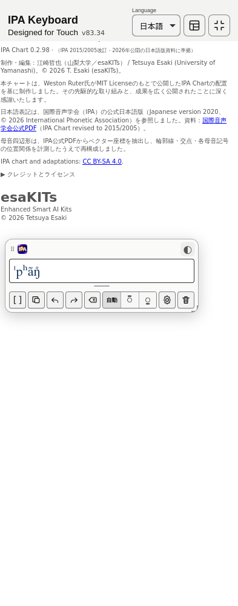
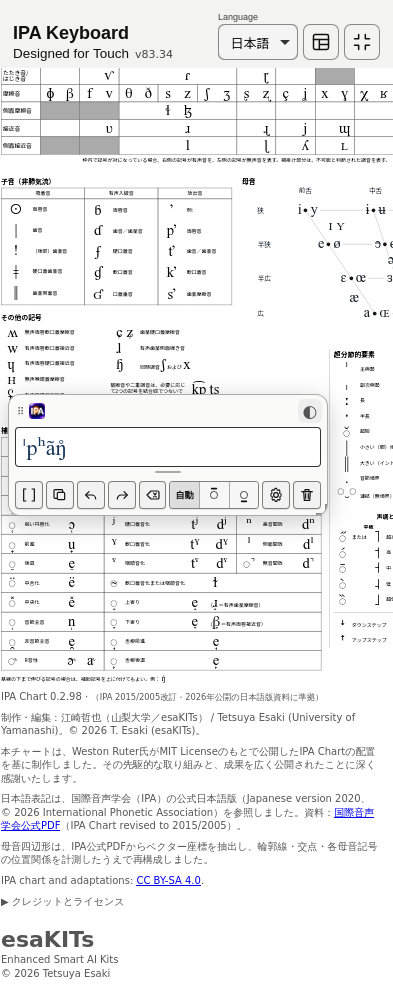
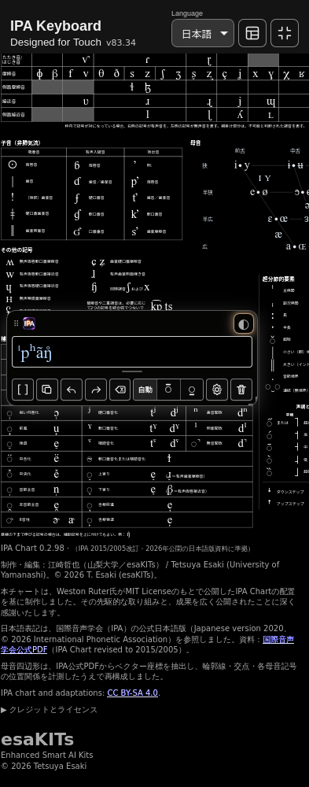

# 拡大表示の下端余白の修正

表示：v83.34。作業ブランチ：work/viewer-gap-20261128。
開始前：0afac47c9172ff5638a0afa06723160e8fb1f684。
開始前復元点：backup/before-viewer-gap-20261128。
実装：78ee36ad6d11b74199161a72ef5e56ec8cde3df4。
最終検証対象：a36784b55bbcc5f0008b88afb2bbbbdc48c49b6f（検証条件を整備したコミット）。

## 原因と変更

入力パネルが拡大画面のどこかに重なると、その上端から画面下端までの長さを末尾の余白として追加していた。中央や上側に移動した入力パネルでも、画面の大部分の高さが余白になっていた。
パネルが実際に画面下端を覆う場合にだけ余白を設ける。パネル下に閲覧可能な領域が残る場合は、末尾の追加余白を0にする。下端を覆う場合は、従来の隠れた内容を上へスクロールできる余白を維持する。

アプリ変更は chart.html の sizeStage 内の余白条件のみ。図形、文字、地図、配色、タイトル、入力パネルの位置・サイズは変更しない。

## 検証

CI：https://github.com/esaKITs/ipa-keyboard/actions/runs/46034128010
Chromium/WebKit × 320/393/768/1280px × 白黒で、変更前の同一コミットを別サーバーで動かし、中央パネルでも200px超の余白が発生することを再現する。
候補版で中央パネル時の追加余白0、パネルを下へ動かした時の実高に応じた余白、ロゴがパネルの上へスクロールできること、パネルを中央に戻すと余白が消えることを検査する。内容自体が画面より短い場合の自然な未充填部分は、追加余白と区別する。
既存 viewer-footer と tap-feedback も再実行する。
実機は未検証。余白比較は日本語で検証し、全言語の全組み合わせは未検証。

確認用：https://esakits-ipa-phase3-20261126.esakit.chatgpt.site
本番main・公開サイトは変更しない。
復元：バックアップブランチのコミットから別ブランチを作成する。

## 結果

run 46034128010：成功。余白比較、viewer-footer、tap-feedback が完了。
比較16環境で中央パネルの不要な追加余白は約612〜616pxから0へ。
WebKit 393px白背景：追加余白614.10px→0、ロゴ下633.47px→19.47px。下端パネル時は138.02pxの余白を確保し、ロゴがパネル上へ見えることを確認。
検証後の復元点：backup/after-viewer-gap-verified-20261128 → a36784b55bbcc5f0008b88afb2bbbbdc48c49b6f。
本番mainは391cd42bca752c4772e0e9c77345a25881210401で不変。
検証対象と確認用のアプリファイルがバイト単位で一致。SVG図形が変更前と同一であることも確認。
配信完了は別途区別する。今回の変更にLucideアイコンの導入は含まない。

[計測結果](viewer-gap-evidence/viewer-gap-results.json)

