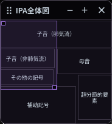
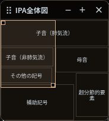
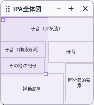

# 配色修正の本番反映（2026-11-27）

ユーザーの本番反映の明示的な許可を受けて実施。

- 表示版：v83.34。
- 本番反映前：`7a96b1917818b0c7ca8d23cd9868fc85f7a242d2`。
- 事前バックアップ：`backup/before-color-release-20261127`（上記コミットと同一）。
- 本番コミット：`ad648a46b0b2bb41b210d6eb695223118dbedf53`。
- 公開先：https://esakits.github.io/ipa-keyboard/
- 検証済み候補：`8cd84e49e79a0c702766e3ad63afc9d7cc55012d`。

## 変更した内容

本番に反映したのは `index.html` と `chart.html` の配色修正だけ。両ファイルが検証済み候補とバイト単位で同じであることを公開前に確認した。テストコード・ワークフロー・報告・証拠画像は作業用ブランチに分離し、main に追加していない。

- 言語選択欄の枠・タップ色：全言語で白背景は紫、黒背景は薄いオレンジ。
- ナビゲーションマップ：白背景の紫は維持。黒背景は選択範囲の枠・角・内側・下地を暖色系に変更し、従来の紫の下地が透ける状態を解消。
- 移動、拡大縮小、入力、フォント、既存依存ライブラリ、SEO、ライセンス、README、GitHubメタデータは変更していない。

## 検証と証拠

公開前：[候補版の検証成功](https://github.com/esaKITs/ipa-keyboard/actions/runs/45959191014)。Chromium / WebKit、320 / 375 / 393 / 768 / 1280px、白黒、全5言語を対象とした。マップ20条件、画像比較8条件、言語欄40条件が成功。選択範囲内の最頻画素は RGB(40,33,25) の暖色。白背景マップの画素差は0。

- [GitHub Pages build / deploy](https://github.com/esaKITs/ipa-keyboard/actions/runs/45960297307)
- [公開サイトの配色・入力・拡大縮小の検証](https://github.com/esaKITs/ipa-keyboard/actions/runs/45960392966)
- [公開サイトの既存機能の回帰テスト](https://github.com/esaKITs/ipa-keyboard/actions/runs/45960298221)

公開サイトの配色検証：成功。マップ20条件、画像比較8条件、言語欄40条件がすべて成功。公開ページの黒背景の枠内は最頻画素 RGB(40,33,25)、白背景の画像差分は0。配信対象22ファイルが本番コミットと一致。

公開サイトの既存機能回帰テスト：成功。GitHub Pages の build / deploy、公開サイトの配色検証、公開サイトの全体回帰テストがすべて完了した。main 専用の public ジョブが成功し、作業ブランチ専用 verify ジョブの skipped は設定どおり。

CUA の Chromium で実際の本番URLを開き、拡大表示、白黒切り替え、言語欄を操作した。黒背景のマップ内側と枠が暖色系であること、白背景の紫が維持されていることをスクリーンショットで目視確認した。

公開配信ファイルの照合結果は `public-files.json`。候補版の詳細な比較画像・検証方法は `work/map-base-evidence-20261127` ブランチの `qa/MAP_BASE_CORRECTION_20261127.md` を参照。

スマートフォン幅はエミュレーション。iPhone / Android実機は未検証。

## 復元方法

事前バックアップは公開前に本番 main と一致することを確認済み。復元時は `backup/before-color-release-20261127` の内容を使った新しい復元コミットを作成し、公開する。履歴を強制的に書き換えない。復元後は公開ファイルと実際のサイトで動作確認する。

検証完了後の復元ポイント：`backup/after-color-release-verified-20261127`。

## 公開サイトの比較画像

実行結果：`live/results.json`。
